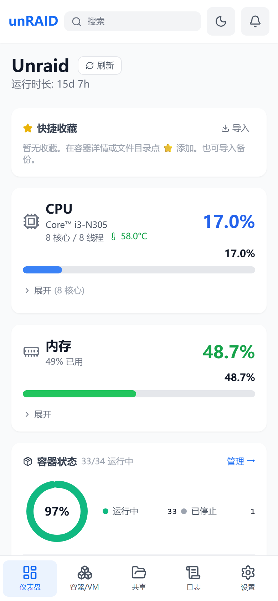
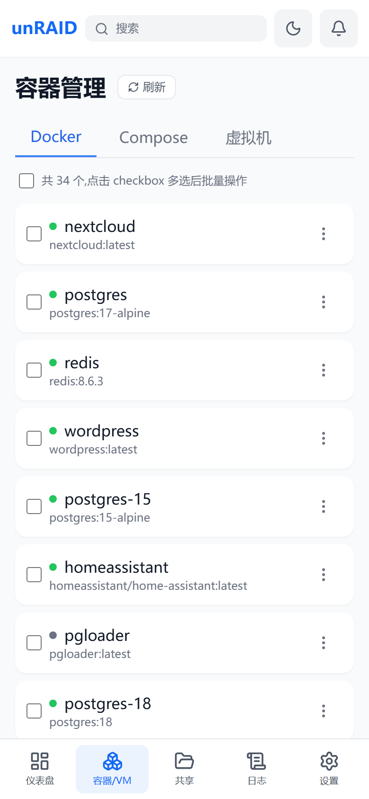
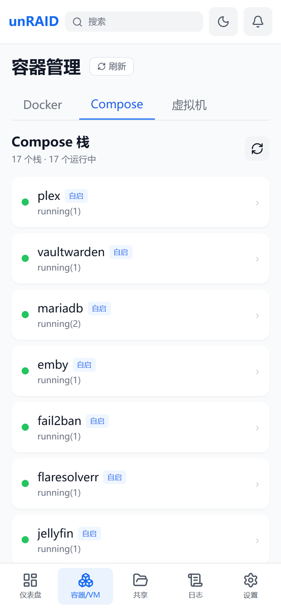
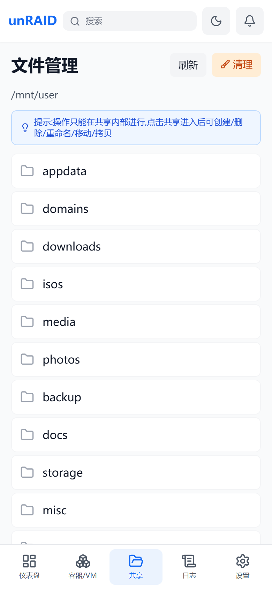
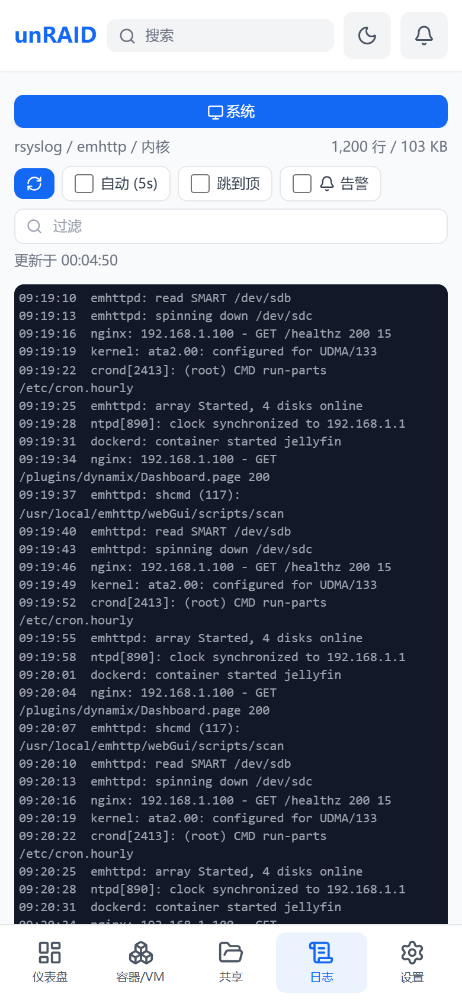
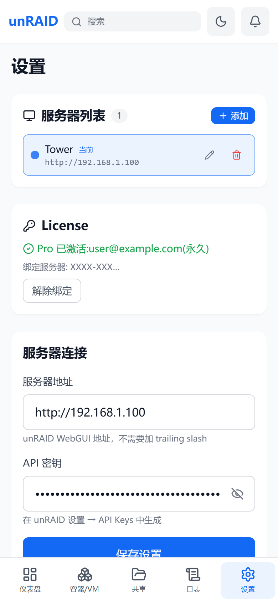

# unRAID Mobile

**English** | [简体中文](README_CN.md)

[](https://t.me/+l1iA02ZkOK1lNmEx)
[](https://testflight.apple.com/join/c9apZvbG)
[](https://hub.docker.com/r/bear0328/unraid-mobile)
[](https://hub.docker.com/r/bear0328/unraid-mobile)

A mobile-optimized management interface for unRAID servers. React 18 + TypeScript + Vite + Tailwind CSS,
single-container deployment, data via the unRAID GraphQL API (7.2+; disk sleep badges and
network rate stats require unRAID 7.3+ / unraid-api ≥ 4.20 — on older versions the app
detects the missing schema fields and degrades gracefully).

## Screenshots

| Dashboard | Containers / VMs | Compose stacks |
|---|---|---|
|  |  |  |

| Share files | Logs | Settings / License |
|---|---|---|
|  |  |  |

## Features (Free / Pro)

| Free (works out of the box) | Pro (unlocked with a license key) |
|------|------|
| Full dashboard monitoring: CPU / memory / network / disks / array / parity-check progress / history charts / favorites, unRAID alert badge | Container & VM start/stop / restart / pause / resume operations, **VM enhanced details**¹ (static libvirt configuration, per-VM live CPU/memory/disk/network metrics, and QEMU/libvirt logs) |
| Container & VM lists, container details (ports/mounts/network/disk usage), container logs, VM basic details | **Compose stack management** (list/logs/up/down/pull/rebuild/yaml editing)¹, **plugin management** (check/install/update/remove, native app)¹ |
| Storage capacity &amp; usage bars, Shares file browsing / download / image preview, read-only disk &amp; pool browsing, host system logs (syslog) | **CPU temperature**¹ (reads /sys/class/hwmon directly, never spins up disks), Shares write operations (upload/mkdir/delete/rename/text editing) |
| Global search, command palette, config backup/import, single server, dark theme, PWA | **One-click container updates** (single/batch, same as webGui), **UPS monitoring** (charge/runtime/load), container batch operations, alert notifications (Webhook), disk cleanup |

¹ Requires the host agent (compose-api) — a small component installed on the unRAID host as described
in "Pro host agent" below. **Installation modifies the boot script `/boot/config/go`; read the risk
notice there first.** The free version requires no host installation at all.

**Host-agent rule:** Compose management / CPU temperature rely on the host-side `api.php`
(installed under `/boot/config/plugins/unraid-mobile/`); these features are Pro.

Pro is a **one-time purchase**: pay once, use forever (includes 1 year of updates). Enter the key in
"Settings → License" to unlock. Legacy keys were retired on 2026-11-18 and must be reissued. New
customer keys bind automatically on first activation, which requires network access and uploads only
SHA-256 hashes of the key and flash GUID — never the full key, raw GUID, or email address. See GitHub
Releases / future announcements for purchase channels.

## Alert notifications (Webhook)

"Settings → Webhook notifications" pushes server events to **Bark / Telegram / Discord /
Feishu (custom bot, signature supported) / Email (Resend) / custom HTTP**. Event sources are
opt-in (only container-stop is on by default):

- State changes: container stop, VM stop, UPS line-power change / low battery, parity-check
  start/finish (sync errors escalate to error), disk status abnormal, array start/stop
- Threshold alerts (with hysteresis + cooldown): CPU usage, memory usage, CPU temperature (Pro),
  disk temperature, UPS low battery
- Others: **unRAID native alert forwarding** (system notification-center ALERT/WARNING, incl.
  SMART), log keyword hits

Disk events follow the existing 30-minute disk-cache cadence — monitoring never spins up
sleeping disks. Template variables: `{{container}} {{state}} {{server}} {{time}} {{category}}`.

## Quick start (Compose)

> There is one Compose file, one application image, and one long-running container. The container has
> no host privileges and never installs Unraid plugins or modifies host files automatically. Bootstrap
> the Pro host agent separately as described below.

```bash
mkdir -p /mnt/user/appdata/unraid-mobile/compose/secrets
cd /mnt/user/appdata/unraid-mobile/compose
curl -fsSL -O https://raw.githubusercontent.com/bear0328/unraid-mobile-compose/master/docker-compose.yml
curl -fsSL -o .env https://raw.githubusercontent.com/bear0328/unraid-mobile-compose/master/.env.example
# Edit .env: set UNRAID_UPSTREAM / UNRAID_SERVER_URL
```

Create the two secret files without echoing values or writing them to shell history:

```bash
read -r -s -p 'WebDAV password: ' SECRET; echo; printf '%s' "$SECRET" > secrets/dav_password
read -r -s -p 'Syslog password: ' SECRET; echo; printf '%s' "$SECRET" > secrets/log_password
unset SECRET
chmod 600 .env secrets/*
docker compose up -d
docker compose logs unraid-mobile
```

Open `http://<unraid-IP>:3999`, enter your unRAID API key and the same WebDAV/syslog passwords in
Settings. The API key stays in the current browser or native device and is not distributed as a Compose
secret. Secret files remain user-owned with mode 600. At startup, the main container creates or verifies
bcrypt credential files without overwriting an existing `settings.json`. The free version is ready at
this point; run `bootstrap-host.sh` below only if you need Pro host features such as Compose management.

## Basic features only: docker run

```bash
docker run -d \
  --name unraid-mobile \
  -p 3999:80 \
  -e UNRAID_UPSTREAM=http://192.168.1.100:8001 \
  -v /mnt/user/appdata/unraid-mobile/config:/usr/share/nginx/html/config \
  bear0328/unraid-mobile:latest
```

Set `UNRAID_UPSTREAM` to your unRAID webGui address (no trailing slash) — the container's nginx
reverse-proxies `/graphql` to it. **A wrong value means all API requests return 502.**

Open `http://<unraid-IP>:3999`, go to "Settings" and fill in:

1. **Server URL** — e.g. `http://192.168.1.100` (your unRAID webGui address, no trailing slash)
2. **API key** — an unRAID GraphQL API key (webGui → Settings → API Keys)

> The API key lives only in your own browser's localStorage and is **never** written to any file on
> the server.

Image tags: `latest` (newest stable) / `1.3.8` (pinned version). linux/amd64 only (unRAID platform).

### Alternative: unRAID Docker UI template

If you prefer the Docker tab UI over the CLI, use the template
[`templates/unraid-mobile.xml`](templates/unraid-mobile.xml):

```bash
# run as root on the unRAID host
curl -fsSL -o /boot/config/plugins/dockerMan/templates-user/my-unraid-mobile.xml \
  https://raw.githubusercontent.com/bear0328/unraid-mobile-compose/master/templates/unraid-mobile.xml
```

Then: Docker tab → **Add Container** → pick **unraid-mobile** in the Template dropdown →
fill in `UNRAID_UPSTREAM` → Apply. Optional mounts (file manager / logs / Compose) are in the
advanced section; delete the rows you don't need.

### Feature ↔ mount matrix

Core features (dashboard/containers/VMs/settings) work with **zero mounts**. Advanced features are
enabled per mount:

| Feature | Mount / dependency | Notes |
|------|------------|------|
| Config persistence | `-v .../config:/usr/share/nginx/html/config` | Stores serverUrl only; recommended |
| File manager | `-v /mnt/user:/mnt/user` + `-v /mnt/cache:/mnt/cache` + WebDAV password file | Password entered in Settings, must match nginx `.davpasswd` |
| Read-only disk/pool browsing (Storage → Disks) | `-v /mnt:/mnt:ro` | Read-only; recreate the container after adding disks/pools |
| Host system logs | `-v /var/log:/hostlog:ro` + log password file | Same idea, `.logpasswd` |
| Compose stacks / CPU temperature (Pro) | `-v /var/run/php-fpm.sock:/hostrun/php-fpm.sock` + host agent | See next section |

The single source of truth is [`docker-compose.yml`](docker-compose.yml), which enables the full mount set by default.
The app now supports one server and always runs only the `unraid-mobile` application container. The
License service is an independent project and is not part of this Compose file.

## Pro host agent (compose-api): Compose / plugins / CPU temperature

Compose, `docker run`, and the Docker UI template only manage the application container; none installs
this host agent automatically. To use these Pro features, explicitly run `bootstrap-host.sh` on the
Unraid host. It validates GraphQL and the API key before invoking the existing idempotent installer.

Compose, plugin management, and CPU temperature (all Pro features) rely on a small host-side component
(`api.php`, executed as root via the host's php-fpm to run `docker compose`, the official `plugin` CLI,
or read `/sys/class/hwmon` directly).
Without it, those features show an install guide or a placeholder; **everything else is unaffected**.

Web and native support Community Applications search, categories, details, HTTPS `.plg` plugin
installation, and official Docker template installation. Plugin jobs run serially in the host background
with logs. Plugin-author scripts run as root: install only trusted sources. Removal and configuration
cleanup are defined by each plugin. Unraid OS updates remain out of scope.

> ⚠️ **Risk notice (read before installing)**
> The install script modifies the following persistent host files (unraid-mobile's own changes are
> tagged 【unraid-mobile】):
> - `Compose Manager Plus`: if missing, installed from a pinned commit in the plugin author's repository;
>   the plugin manages its own files and configuration
> - `/boot/config/go`: the boot script — a 6-line restore hook is appended so the Pro backend
>   is restored after reboots and stale Compose locks are cleaned
> - `/boot/config/plugins/unraid-mobile/api.php`: flash master of the Pro backend
>   (Compose / CPU temperature / VM details)
> - `/boot/config/plugins/unraid-mobile/plugin-worker.php`: flash master of the plugin job worker
> - `/boot/config/plugins/unraid-mobile/update-status.php`: flash master of the Compose
>   update-badge write-back script
> - `/boot/config/plugins/unraid-mobile/apikey`: API key stored as a sha256 hash (FAT permissions are mount-controlled,
>   plaintext never touches the flash drive)
> - `/boot/config/plugins/unraid-mobile/audit.log`: audit log of key api.php operations
> - `/boot/config/go.unraid-mobile-bak`: automatic backup of `go` taken before any change
>
> Safeguards:
> - The original `/boot/config/go` is backed up to `/boot/config/go.unraid-mobile-bak` first
> - Only tagged 【unraid-mobile】 hook lines are appended; none of your existing lines are touched
> - The script asks you to type `YES` explicitly before doing anything
> - To remove the host agent, delete `/boot/config/plugins/unraid-mobile/` and the tagged hook lines
>   in `go`. If you no longer need the automatically installed Compose Manager Plus, remove it separately
>   through Unraid's plugin manager.
>
> If you do not accept any modification to the boot script, do not install — every free feature
> works without it.

The free version needs no third-party Unraid plugins. The Pro host agent's only additional plugin
dependency is **Compose Manager Plus** (its internal plugin ID remains `compose.manager`, sharing the
same directories as the legacy plugin); **neither Community Applications nor User Scripts is required**.
These commands create a private temporary directory on Unraid and download the host bootstrap plus the
existing installer. The installer downloads the remaining agent files, verifying `api.php` and
`plugin-worker.php` with SHA-256:

```bash
# Run as root in an SSH session or terminal on the Unraid machine
um_install_dir="$(mktemp -d /tmp/unraid-mobile-install.XXXXXX)" \
  && mkdir -p "$um_install_dir/scripts" "$um_install_dir/compose-api" \
  && curl -fsSL -o "$um_install_dir/scripts/bootstrap-host.sh" \
    https://raw.githubusercontent.com/bear0328/unraid-mobile-compose/v1.5.15/scripts/bootstrap-host.sh \
  && curl -fsSL -o "$um_install_dir/compose-api/install-compose-api.sh" \
    https://raw.githubusercontent.com/bear0328/unraid-mobile-compose/v1.5.15/compose-api/install-compose-api.sh \
  && bash "$um_install_dir/scripts/bootstrap-host.sh"
```

The bootstrap validates the API key against `http://127.0.0.1/graphql` by default; append
`--upstream http://127.0.0.1:8001` if GraphQL listens at a different local address. Only after validation
does the installer run: risk confirmation (type YES) → detect compose.manager (**skip when Plus or a
compatible legacy version is already installed**; otherwise install Compose Manager Plus through Unraid's
official `plugin` command) → store the API key as a `sha256:` hash in
`/boot/config/plugins/unraid-mobile/apikey` (plaintext never touches the flash drive) → install api.php
into the Compose Manager Plus plugin directory → back up and append the `/boot/config/go` restore hook.
It is safe to re-run and never reinstalls an existing plugin. `--local-only` is for offline recovery; in
that mode a missing Compose Manager Plus causes a clear error instead of a network install.

Compose already mounts php-fpm.sock. With `docker run` or a custom template, add that mount and recreate
the container; the Compose tab and CPU temperature (once Pro is activated) are then ready.

### Later upgrades

- The Docker container and host agent are separate components. The native app can update the image through **Containers → unraid-mobile → Update Image**. The `appVersion` shown in Settings belongs to the running host `api.php`; it does not prove that the container image is current.
- When an `apikey` already exists, rerunning the installer preserves it by default and no longer prompts for a key. Only an explicit `--reset-key` rotates it; afterwards, Web and every app installation must use the same new key.
- Starting with v1.5.11, Pro users can synchronize the host agent from **Settings → About** in either the native app or Web. The updater downloads only a pinned official release, verifies every file with SHA-256 before installation, and preserves the existing API-key hash and License receipt.
- An independent host worker survives client disconnects and supports request-ID recovery. Managed files are backed up before installation, with rollback attempted after installation or version-verification failures. Downgrades are rejected.
- **Initial installation still requires root in the Unraid web terminal or SSH. A v1.5.10 or older agent does not know the synchronization endpoint and must be manually updated to v1.5.11 one final time before later releases can synchronize in place.**

## Build from source

```bash
git clone https://github.com/bear0328/unraid-mobile.git
cd unraid-mobile
npm ci
npm run build        # output in dist/
npm test             # vitest
docker build -t unraid-mobile .
```

## unRAID GraphQL API limitations

### Docker containers
| Feature | Supported | Fields |
|------|------|------|
| List | ✅ | id, names, image, state, status, autoStart, created |
| Logs | ✅ | logs(tail) { lines { timestamp, message } } |
| Stats | ✅ | stats { cpuPercent, memUsage, memPercent } (subscription) |
| Start/stop | ✅ | mutation |
| Standalone container parameter editing | ✅ (Pro) | Native iOS; compose-api edits the Unraid user template and recreates through official `xmlToCommand` |
| Port mappings / mounts / network / disk usage | ✅ | ports / mounts / networkSettings / size* (details query) |

### Virtual machines
| Feature | Supported | Fields |
|------|------|------|
| List | ✅ | domains { name, uuid, state } |
| Start/stop | ✅ | mutation |
| Static configuration | ✅ (Pro) | libvirt XML via compose-api: vCPU/memory allocation/disks/network/passthrough/snapshots/firmware |
| Live metrics / QEMU logs | ✅ (Pro) | libvirt domstats counters and QEMU/libvirt logs via compose-api; sampling only in the visible single-VM details view |

## Changelog

Full history in [CHANGELOG.md](CHANGELOG.md).

### TestFlight 2.0.0 (159) (2026-11-28)

- Consolidated the unRAID WebGUI address into Settings → Current Server → Edit Server, removing the duplicate Features & Services entry
- Editing or clearing only the WebGUI address no longer requires another App/API connection test; changing the server URL or API Key still requires verification
- Native app only; Web, Docker, and compose-api remain at v1.5.15, with no server deployment or install-script rerun needed. All 966 native XCTest cases and all 1,954 Vitest cases pass

### TestFlight 2.0.0 (158) (2026-11-28)

- Host authentication failures now show API Key Mismatch with a direct Edit Server action. Connection checks separate GraphQL and host-agent authorization, while free features remain usable without a host agent
- Coordinated with Web/Docker and compose-api v1.5.15; all 965 native XCTest cases pass

### v1.5.15 (2026-11-28)

- The installer preserves an existing `apikey` by default and rotates it only with explicit `--reset-key`, preventing routine upgrades from breaking Web/App host authorization
- Native diagnostics distinguish GraphQL, host authorization, and network failures; v1.5.14 hosts can synchronize in place

### TestFlight 2.0.0 (157) (2026-11-28)

- Simplified legacy host-agent upgrades to one Copy Upgrade Command button, using a fresh temporary directory and pinned installer while preserving the API key and avoiding an old payload
- Docker updates point directly to the native container detail. Coordinated with Web/Docker and compose-api v1.5.14; all 961 native XCTest cases pass

### v1.5.14 (2026-11-28)

- Native and Web now provide a copyable manual host-agent upgrade command with a fresh temporary directory and pinned installer, preventing reuse of an old installer's `api.php`
- compose-api only advances `APP_VERSION` to 1.5.14 with no new host functionality; v1.5.13 hosts can synchronize in place

### TestFlight 2.0.0 (156) (2026-11-28)

- Unified native player chrome and loading/error states, with a compact media summary, clearer primary controls, double-tap ±15-second seek, startup timeout protection, and automatic resume with a Start from Beginning action
- Moved subtitle/audio settings into a scrollable panel that works during playback. Retries preserve current-session progress, long-press previews restore the previous rate, landscape follows the actual window, and WebDAV/STRM/Emby/Jellyfin share one source loader
- Native app only; Web, Docker, and compose-api remain at v1.5.13, with no install-script rerun needed. All 960 native XCTest cases pass

### TestFlight 2.0.0 (155) (2026-11-28)

- Renamed Shares to Storage and added comments, complete capacity details, and usage bars to share and disk rows, with matching category and global-search wording
- Added first-load skeletons, stale-data warnings with retry, and partial pool-failure status. Legacy snapshots remain compatible; shares and pools load concurrently without added polling
- Native app only; Web, Docker, and compose-api remain at v1.5.13, with no install-script rerun needed. All 952 native XCTest cases pass

### TestFlight 2.0.0 (154) (2026-11-28)

- Library cards now use 16:9 landscape artwork, fixing image overflow and card overlap. All 948 native XCTest cases pass

### v1.5.13 (2026-11-27)

- Unified the confirmed orange brand artwork across native, Web/PWA, Capacitor splash screens, and the public deployment repository, with platform-native rounded presentation
- Continue Watching now shows one series card per show with the latest resumable episode, series artwork, and direct resume; movies remain independent
- Coordinated with TestFlight 2.0.0 (149). compose-api only advances `APP_VERSION` to 1.5.13, with no new host functionality; v1.5.12 hosts can synchronize in place

### TestFlight 2.0.0 (149) (2026-11-27)

- Continue Watching collapses episodes into one card per series, ordered by recent playback. Cards show the series title and poster with episode details underneath, while tapping resumes the latest episode directly
- Updated the app icon to the confirmed orange design with native iOS continuous rounding. All 948 native XCTest cases pass

### v1.5.12 (2026-11-27)

- Native Settings now uses seven groups with unified Pro and credential flows, dedicated host-agent status, snapshot-bound connection tests, verified Keychain operations, and transactional configuration restore. Polling and appearance preferences join automatic backups
- Nginx `/config/` exposes only exact `settings.json` GET/OPTIONS publicly; other configuration, including License records and `app-backup`, requires DAV authentication by default. Backups contain secrets and are protected by WebDAV authentication, not encryption
- Coordinated with TestFlight 2.0.0 (145). compose-api only advances `APP_VERSION` to 1.5.12, with no new host functionality; v1.5.11 hosts can synchronize in place without a manual install-script rerun

### TestFlight 2.0.0 (145) (2026-11-27)

- Reorganized Settings into seven groups with a unified Pro entry, consistent credential save/validate/clear behavior, and a dedicated host-agent subpage with backend status
- Added validated-snapshot connection tests, Keychain write/delete read-back verification with failure recovery, complete restore preflight, transactional commit/rollback, strict version/ID/URL rejection, safe cache paths, and automatic backup of polling/appearance preferences
- Full native XCTest 943/943, the latest targeted suite 59/59, and Vitest 1951/1951 pass; simulator light/dark and large-text checks pass. Real-device interactions remain subject to user acceptance

### v1.5.11 (2026-11-27)

- Native App and Web Settings now synchronize the Pro host agent from a pinned official release, with full-package SHA-256 verification, pre-install backups, rollback, preserved API-key/License credentials, and request-ID recovery
- Web activation failures now show visible errors and always clear the busy state; host-authorization synchronization failures link directly to the host-agent updater
- Coordinated with TestFlight 2.0.0 (141). Initial installation still requires root; a v1.5.10 or older host agent must be manually updated to v1.5.11 one final time

### TestFlight 2.0.0 (141) (2026-11-27)

- Added native Pro host-agent synchronization with progress logs, disconnect recovery, clear rollback results, and neutral handling when the outcome cannot be confirmed
- Settings now identifies `appVersion` as the host-agent version rather than the Docker image version; coordinated with Web/Docker and compose-api v1.5.11

### TestFlight 2.0.0 (140) (2026-11-27)

- Added background audio with independent audio-session management, interruption recovery, headphone-unplug pause, route-change handling, and lock-screen/Control Center playback controls
- Added music queues for the current WebDAV folder and currently loaded Emby/Jellyfin audio, including sequential/shuffle playback, list/single-track repeat, previous/next, automatic advance, resume, and Emby/Jellyfin progress reporting
- Preserved the existing video player and original-quality Direct Play path without automatic transcoding; switching tracks isolates saved progress and reporting between the old and new items
- Native app only; Web, Docker, and compose-api remain at v1.5.10, with no install-script rerun needed. PiP is not included; real-device background, interruption, route, and queue validation remains required

### TestFlight 2.0.0 (139) (2026-11-27)

- Redesigned the native Emby/Jellyfin media center with Continue Watching, latest library items, poster/list layouts, artwork caching, and isolated offline directory snapshots. Cached entries never include media paths or remote STRM sources
- Direct Play now preserves one consistent media source across streaming and reporting, with explicit retry and manual original-quality source selection. Playback failures identify server/error-document responses instead of misreporting them as decoder failures; no automatic remux or transcoding is added
- Added lock-screen and Control Center artwork, progress, play/pause, 15-second skip, and supported seek commands. Player lock blocks system controls too; background audio, PiP, and music queues are not included
- Native app only; Web, Docker, and compose-api remain at v1.5.10, with no install-script rerun needed

### v1.5.10 (2026-11-27)

- Docker installation states now rely only on actual running or stopped containers. Leftover user templates and community templates no longer cause false positives, while plugin detection is unchanged
- Coordinated with TestFlight 2.0.0 (138). **Re-run the host install script after upgrading** to deploy the updated compose-api

### TestFlight 2.0.0 (138) (2026-11-27)

- Playback reporting adds bounded Started retries, latest-only Progress coalescing, and prioritized Stopped flushing. Remote probes read only the first byte, cross-origin redirects drop original credentials, and reports use real seek capability
- Removed the duplicate App Store entry from the container overview while retaining it in Settings. Requires the coordinated v1.5.10 host agent; **re-run the host install script after upgrading**

### v1.5.9 (2026-11-23)

- Native one-click updates now cover standalone Docker, compose.manager stacks, and external Compose projects. A categorized confirmation lists every pending container/project, and each Compose project is pulled and recreated only once with its original configuration
- External Compose jobs add project locking, live identity/spec validation, request-ID recovery, safe active-job attachment, complete logs, and immediate update-badge refresh; they never fall back to standalone updates
- Coordinated with TestFlight 2.0.0 (137). **Re-run the host install script after upgrading** to deploy the new compose-api endpoints

### TestFlight 2.0.0 (137) (2026-11-23)

- “Update All” and selected-container updates include every updatable Docker container, with separate standalone, compose.manager, and external Compose lists plus per-project progress and results
- Container details update the owning external Compose project safely. Reattachment works during anchor-container recreation and preserves real terminal or indeterminate outcomes
- Requires the coordinated v1.5.9 host agent; **re-run the host install script after upgrading**

### v1.5.8 (2026-11-23)

- Support both Unraid 7.4 `flashGUID` and legacy `flashGuid`, fixing Pro identity lookup failures that blocked “Update All” and other Pro actions before execution
- compose-api backend fix only; device-binding hashes and license rules are unchanged, and native app features are unaffected. **Re-run the host install script after upgrading**

### TestFlight 2.0.0 (136) (2026-11-23)

- CPU, GPU, memory, network, disk, and Parity cards collapse into single-line summaries with independently persisted states. All cards start expanded and can be toggled from the title row or long-press menu
- Collapsing does not change polling, fetch disk details, or spin up disks. Dashboard card source files are also organized by type without changing the existing interface or behavior
- Native app only; Web, Docker, and compose-api are unchanged, with no install-script rerun needed

### TestFlight 2.0.0 (135) (2026-11-23)

- The dashboard adds pull-to-refresh without fetching disk details or spinning up sleeping disks; an unloaded disk card now offers guidance and a “Fetch Disk Details” action
- Coordinated with Web/Docker v1.5.7. **Re-run the host install script after upgrading** to enable the GPU sampling optimization

### v1.5.7 (2026-11-23)

- GPU metrics use a shared four-second cache instead of launching external samplers on every one-second poll. CPU power and memory remain live, and the Web container summary removes its duplicated count
- Coordinated with TestFlight 2.0.0 (135). **Re-run the host install script after upgrading** to deploy the updated compose-api

### TestFlight 2.0.0 (134) (2026-11-23)

- Container updates, lifecycle actions, parameter editing, and batch jobs are mutually exclusive. Each batch retains its original server and configuration, stopping remaining mutations after a configuration change to prevent cross-configuration writes
- Compose and standalone containers report update results incrementally. Lost responses, timeouts, and undispatched items use a neutral “outcome pending” state; special stack names are correctly escaped for details, logs, and YAML saves
- Containers, Compose, and VMs share neutral cards, tappable summary filters, resilient long-text and large-text layouts, and row-level VoiceOver activation. VM state normalization and log-session rebuilds now respect configuration changes
- Native app only; Web, Docker, and compose-api are unchanged, with no install-script rerun needed

### v1.5.6 (2026-11-23)

- Standalone Docker updates add request IDs, idempotent recovery, identity/Compose/template rechecks, and process-group orphan recovery; indeterminate outcomes are explicitly reported as `unknown`
- Coordinated with TestFlight 2.0.0 (133). **Re-run the host install script after upgrading** to deploy the updated compose-api

### TestFlight 2.0.0 (133) (2026-11-23)

- Unifies Compose ownership across details, multi-selection, and updates; container rows appear before update/icon enrichment, with stable sorting, true filtering, a Community Applications shortcut, and editing-limit guidance
- Logs add cursor fallback, lifecycle recovery, and a 3,000-line limit. Lost update responses recover by the original request ID without replay, with unknown outcomes shown as neutral “outcome pending”
- Coordinated with Web/Docker v1.5.6. **Re-run the host install script after upgrading**

### v1.5.5 (2026-11-23)

- Web containers now use explicit multi-selection, consistent loading, empty, cached-error, and long-text layouts, with update results accurately separated into success, partial completion, and failure
- Coordinated with TestFlight 2.0.0 (132). **Re-run the host install script after upgrading** to align compose-api release metadata

### TestFlight 2.0.0 (132) (2026-11-23)

- Retains the container/Compose/VM selection menu while fixing overlap with the floating iOS 26 tab bar and obscured filtered empty states
- Improves cached errors, long Compose text, VM UUIDs, update outcomes, collapsible failure details, and Reduce Motion behavior
- Coordinated with Web/Docker v1.5.5. **Re-run the host install script after upgrading** to align compose-api release metadata

### v1.5.4 (2026-11-23)

- Fixed filtered selections leaking into batch actions, missing Docker auto-start/creation fields, stats recovery, concurrent row loading, and overlapping or stale live-log requests
- Added URL-synchronized accessible tabs, independent Docker/VM freshness, clearer empty/loading states, safe-area-aware batch controls, and larger touch targets; metadata loading and log rendering are faster
- Web/Docker UI release; native app features are unchanged. **Re-run the host install script after upgrading** to align compose-api release metadata

### TestFlight 2.0.0 (128) (2026-11-22)

- Settings → About now separates **unRAID-Mobile App** and **unRAID-Mobile Docker**, showing both installed versions and an update-available notice when the Docker/backend is older
- Manual guidance covers updating the container, re-running the host install script, and refreshing to confirm. Legacy backends, network failures, and newer backends are handled without false upgrade or downgrade prompts
- Coordinated with Web/Docker v1.5.3 and compose-api. **Re-run the host install script after upgrading**

### v1.5.3 (2026-11-22)

- Web and native About sections display the App and Docker/host-agent versions independently, with clear manual upgrade steps when the backend is behind the App's companion release
- compose-api `capabilities` now reports `appVersion`; the release script automatically synchronizes the backend, package, and native companion version values
- Web, TestFlight 2.0.0 (128), and compose-api require a coordinated upgrade. **Re-run the host install script after upgrading**

### TestFlight 2.0.0 (127) (2026-11-22)

- Fixed Emby episode resume choices being hidden by a local zero-position entry. Valid server positions now offer Resume / Start from Beginning, while valid local resume entries retain priority
- Playback reporting waits for the resume choice so an initial zero position cannot clear the server record. Progress is synchronized during playback, seeking, pausing and closing, and the media list refreshes after playback
- Native app only; Web, Docker and compose-api are unchanged, with no install-script rerun needed

### TestFlight 2.0.0 (126) (2026-11-22)

- Added local compose-api License signature verification and a machine-bound receipt. The full key goes only to the user's own Unraid host agent, while the central service still receives SHA-256 hashes only. First activation still requires central online binding; local synchronization failure does not block other Pro features
- Added UI and Store Pro enforcement for container, VM and parity actions. Keychain save failures no longer report false activation success, and Docker updates no longer repeat mutations after ambiguous errors
- Coordinated with Web/Docker v1.5.2 and the new compose-api. **Re-run the host install script after upgrading**; older clients receive 403 from Pro host-agent routes

### v1.5.2 (2026-11-22)

- compose-api verifies License ECDSA signatures, expiration and machine-bound receipts on Pro routes. Establishing a receipt on a new host agent requires network access once, after which offline verification works; the central service still stores hashes only
- Failed Web activation restores the previous authorization, and a temporarily unavailable host agent does not block other Pro features. Single Docker updates no longer repeat GraphQL mutations after timeouts, network errors or 403/502/503
- Web, TestFlight 2.0.0 (126) and compose-api require a coordinated upgrade. **Re-run the host install script after upgrading**

### TestFlight 2.0.0 (125) (2026-11-22)

- Targeted MPEG-TS seeks that still froze on the target frame in build 124 while audio continued. For affected streams with large PTS/DTS reordering gaps, the TS avformat software-decode path now outputs late frames instead of repeatedly discarding them after a seek
- Kept the TS player/canvas restart behavior from build 124; MP4, MKV and other containers retain their existing output and in-place seek behavior
- Native app only; Web, Docker and compose-api are unchanged, with no install-script rerun needed

### TestFlight 2.0.0 (124) (2026-11-22)

- Addressed devices where build 123 still left MPEG-TS seeks frozen on the target frame while audio continued. The avformat software-decode path now recreates the entire VLC player and video canvas, isolates delayed callbacks from the old player, and no longer replaces only the media input
- TS seeks preserve play/pause state, audio/subtitle tracks, external subtitles, playback rate and subtitle delay; MKV, MP4 and other containers keep in-place seeking
- Native app only; Web, Docker and compose-api are unchanged, with no install-script rerun needed

### TestFlight 2.0.0 (123) (2026-11-22)

- Addressed MPEG-TS seeks where audio continued but the picture remained frozen. TS sources using the avformat software-decode path now reopen at the target time to rebuild demuxing, decoding and video output, while preserving play/pause state, audio/subtitle tracks and external subtitles; other containers keep in-place seeking
- Native app only; Web, Docker and compose-api are unchanged, with no install-script rerun needed

### TestFlight 2.0.0 (122) (2026-11-22)

- Addressed remote Emby/STRM MPEG-TS playback on some devices where the timeline advanced after build 120 but the picture remained frozen. TS sources using the FFmpeg demuxer now use software decoding to avoid the VideoToolbox output compatibility issue; MKV, MP4 and other containers keep their existing decode paths
- Native app only; Web, Docker and compose-api are unchanged, with no install-script rerun needed

### TestFlight 2.0.0 (121) (2026-11-22)

- Added Jellyfin alongside Emby in the native player. Choose the service type in Settings → Media Servers, then browse libraries and artwork, switch users, Direct Play original streams, resume playback and report progress through the existing player
- Jellyfin API, artwork and VLC playback requests use the required MediaBrowser authorization, including subsequent Range/seek requests. Reverse-proxy subpaths are preserved, and remote STRM sources never receive the media server's API key
- Existing Emby configurations, keychain credentials and local resume entries remain compatible. Server-side transcoding is still not included; native app only, with no Web, Docker or compose-api changes

### TestFlight 2.0.0 (120) (2026-11-22)

- Fixed remote Emby/STRM MPEG-TS videos that showed the first frame but then stalled or ended early. Recognized TS sources now use VLCKit's FFmpeg demuxer, including extensionless CDN URLs with generic MIME types, without transcoding or changing MKV/MP4 playback
- Videos that end far before their known duration now show a retryable playback error instead of silently appearing to finish
- Native app only; Web, Docker and compose-api are unchanged, with no install-script rerun needed

### TestFlight 2.0.0 (119) (2026-11-21)

- Sort field and direction are saved independently per Emby server, user and directory, so libraries, series and seasons no longer overwrite one another and each choice survives navigation and relaunch
- Series and season directories default to ascending season/episode number rather than title order; other sort choices remain available and are remembered per directory
- Native app only; Web, Docker and compose-api are unchanged, with no install-script rerun needed

### TestFlight 2.0.0 (118) (2026-11-21)

- Episode lists and playback titles now include season and episode numbers, such as `S01E03 · Episode Name`; specials support `S00`, while items without numbers keep their original names
- Sort field and direction are saved per Emby server and user, then restored after changing folders or tabs and after relaunching the app
- Native app only; Web, Docker and compose-api are unchanged, with no install-script rerun needed

### TestFlight 2.0.0 (117) (2026-11-21)

- Added a persistent red "Delete Server" button at the bottom of each Emby server edit page, so deletion no longer depends on a list swipe. Confirmation is still required; only local settings and the API key are removed, leaving the Emby server untouched
- Native app only; Web, Docker and compose-api are unchanged, with no install-script rerun needed

### TestFlight 2.0.0 (116) (2026-11-21)

- Added multiple Emby servers with multiple users per server. Add, edit and remove servers in Settings, then switch users by server from the Player toolbar while preserving each server's last selection
- API keys are stored separately in the device keychain. Libraries, artwork and playback progress are isolated by server and user, and late responses from a previous selection cannot replace the current library
- Existing single-server settings, keychain credentials and local resume entries migrate automatically. Native app only; Web, Docker and compose-api are unchanged, with no install-script rerun needed

### TestFlight 2.0.0 (115) (2026-11-21)

- Promoted the Emby library to a dedicated Player tab and removed the duplicate Emby entry from Shares. Emby server configuration remains in Settings
- Moved System Logs into Settings → Logs. Notification details still open logs with their filter applied, and existing filtering, auto-refresh, line limits and export are preserved
- Native app only; Web, Docker and compose-api are unchanged, with no install-script rerun needed

### TestFlight 2.0.0 (114) (2026-11-21)

- Fixed black screens for remote Emby STRM movies and episodes. VLCKit now plays remote HTTP media directly with its User-Agent instead of receiving an upstream error through Emby's proxy; local files still use Emby streams
- Added name, date added, premiere date and community rating sorting with ascending/descending order to Emby directories. Pagination retains the selected sorting
- Native app only; Web, Docker and compose-api are unchanged, with no install-script rerun needed

### TestFlight 2.0.0 (113) (2026-11-21)

- Added a native Emby player: configure the server URL, API key and library user in Settings, then open Emby from the Shares toolbar menu. The API key is stored only in the device keychain
- Browse libraries and series folders with pagination and artwork, play original streams through Direct Play, and reuse the existing VLCKit audio, subtitle, rate, fullscreen and lock controls. Emby resume positions are loaded and playback progress is reported back
- Native app only; Web, Docker and compose-api are unchanged, with no install-script rerun needed. Emby server-side transcoding is not included in this release

### TestFlight 2.0.0 (112) (2026-11-21)

- Restored standard left-aligned large titles in Containers and Shares, with dedicated toolbar dropdown buttons for reliable switching between Containers / Compose / VMs and Shares / Disks. Fixes the misplaced title and unresponsive title menu in build 111
- Logs now places Refresh in the toolbar and Auto refresh / Jump to top / Alerts in an adjacent options menu, removing the persistent control row while preserving filtering, line limits, export, and alert banners
- Native app only; Web, Docker and compose-api are unchanged, with no install-script rerun needed

### TestFlight 2.0.0 (111) (2026-11-21)

- Replaced the persistent segmented controls in Containers and Shares with navigation-title menus, reclaiming vertical space for lists and search. Containers switches between Containers / Compose / VMs, while Shares switches between Shares / Disks
- Added a visible dropdown indicator and preserved search, sorting, refresh, batch actions, and existing navigation. Native app only; Web, Docker and compose-api are unchanged, with no install-script rerun needed

### TestFlight 2.0.0 (110) (2026-11-21)

- Added the current video track's nominal bitrate to the compact player summary. Missing track values are omitted rather than replaced with input or Demux aggregate bitrate
- Simplified codec labels: H.264 no longer appears as `H264 - MPEG-4 AVC (PART 10)`, and AAC no longer appears as `MPEG AAC AUDIO`
- Native app only; Web, Docker and compose-api are unchanged, with no install-script rerun needed

### TestFlight 2.0.0 (109) (2026-11-21)

- The player controls now include a compact lower-left media summary with video resolution, codec and frame rate, plus the current audio track's codec, channels, language and nominal bitrate. Missing fields are omitted and audio-track changes update the summary
- Added playback-control locking: progress, playback, settings and close controls are blocked while locked. Tapping the video reveals only an unlock button, which hides again after five seconds of inactivity
- The summary is cached after playback starts and refreshed only on track changes rather than on every progress update. Native app only; Web, Docker and compose-api are unchanged, with no install-script rerun needed

### TestFlight 2.0.0 (108) (2026-11-21)

- The native player adds media details with video codec, resolution, frame rate, nominal bitrate, audio/subtitle tracks, and live playback statistics. The details panel supports half/full-screen presentation and moves into the playback settings menu on narrow screens
- MobileVLCKit is upgraded to 3.7.5 with upstream security and crash fixes. This does not include 4.0's Dolby Vision Profile 5 support, so MKV P5 color issues remain pending future playback-engine support
- Native app only; Web, Docker, and compose-api are unchanged, with no install-script rerun needed

### v1.5.1 (2026-11-21)

- Fixed automatic matching ignoring `file://` local icons in user Docker templates, allowing Unraid Mobile and other containers and their Compose stacks to show existing icons
- Local icons are limited to Unraid's standard `docker-icons` directories, validated and served with API-key authentication without exposing host paths. compose-api is updated, so **re-run the install script after upgrading**; no new native build is required

### v1.5.0 (2026-11-21)

- Web and native iOS now show application icons in Docker and Compose lists and details. Automatic matching covers user/community templates, Community Applications, and Dashboard Icons; Compose favors matching primary containers/services to avoid adopting an auxiliary container's icon
- Web details add custom HTTPS icons, local PNG/JPEG/WebP uploads up to 2 MB, and restoration of automatic matching. Settings live on Unraid and sync to the app without changing Docker templates or Compose files or recreating containers. Uploaded images require API-key authentication, and public image requests never receive the key
- compose-api is updated, so **re-run the install script after upgrading**. Native changes ship in TestFlight 2.0.0 (107)

### v1.4.9 (2026-11-20)

- Native iOS adds Pro parameter editing for standalone Docker containers through Unraid user templates, with background progress, secret preservation, running-state retention, conflict protection, and failure recovery
- Existing local images are reused without pulling or upgrading; Compose members, containers without user templates, Tailscale-specific containers, and renaming remain excluded. compose-api is updated, so **re-run the install script after upgrading**. Native changes ship in TestFlight 2.0.0 (104)

### v1.4.8 (2026-11-19)

- Added safe read-only Web text previews and expanded NFO, subtitle, playlist, image, audio, video, and QuickLook document format support across Web and native iOS
- Added clear fallback handling for unsupported Web video decoding and native QuickLook documents

### v1.4.7 (2026-11-19)

- Preserved existing DAV/syslog bcrypt credentials during single-container upgrades when only empty placeholder secrets are available; fresh installs still reject empty secrets

### v1.4.6 (2026-11-19)

- Consolidated deployment into one Compose file, one application image, and one unprivileged container; retired setup/router and multi-server mode across Web and native apps, with active-only backup and migration
- Added separate idempotent Pro host bootstrap and improved media previews, Chinese subtitles, and file-type icons

### v1.4.4 (2026-11-16)

- Fixed the Web alert popover heading continuing to show the total alert count after items were read; its unread count now decreases together with the bell badge

### v1.4.3 (2026-11-16)

- Web alerts now support per-item and bulk read actions. The badge counts only unread alerts, read state persists per server, and alert history remains available after the count reaches zero

### v1.4.1 (2026-11-15)

- Single-server Compose no longer starts or depends on the router. Web multi-server forwarding is opt-in through the `multi-server` profile, and Nginx starts normally when the router is absent

### v1.4.0 (2026-11-15)

- Full-featured Compose now uses `setup + Web + router`: one-shot host-agent setup, an unprivileged Web container, and whitelist-only protocol forwarding. Web multi-server adds independent DAV/syslog credentials with target-isolated queries, caches, connections, and destructive actions
- Container updates safely fall back to GraphQL when compose-api is unavailable. Fixed stale responses, stats streams, caches, and port-qualified Host handling crossing targets; unknown routes, arbitrary upstreams, duplicate addresses, and missing credentials fail closed

### v1.3.33 (2026-11-15)

- CA installs drop the `$_POST`/`CreateDocker.php` coupling: the CA template XML is written directly as a `my-<name>.xml` user template and created via the official `update_container` script (the same path as container updates), with `docker pull` run first for progress. compose-api is updated, so **re-run the install script after upgrading**

### v1.3.32 (2026-11-15)

- Debug page adds a host-capabilities card backed by a new compose-api `?action=capabilities` endpoint: Unraid/PHP versions, boot-vs-live api.php hash check, boot-restore errors, and per-dependency availability so features degrade clearly after an Unraid OS upgrade. A host-side `scripts/verify-host-compat.sh` runs the same checks over SSH
- Install script adds `--local-only` so OS-upgrade recovery never pulls the older pinned release over local fixes, plus optional `SHA256SUMS` checksums; the boot-restore hook now logs failures to `restore-error.log` and stays idempotent through marker-based range deletion
- deploy-stable.sh resolves the real remote path with `readlink -f` because Unraid 7.4 ships rsync 3.5, which refuses to follow the nobody-owned `/mnt/user/appdata` symlink. compose-api and the install script are updated, so **re-run the install script after upgrading**

### v1.3.31 (2026-11-15)

- Native Dashboard resource cards now show only core percentages or network RX/TX rates and lightweight trends by default, with detailed metrics and controls available on expansion. Native changes ship in TestFlight 2.0.0 (87)
- File-index stale locks now self-heal after crashes or reboots by validating the PID and process command before cleaning abandoned lock and temporary files. compose-api and the index builder are updated, so **re-run the install script after upgrading**

### v1.3.30 (2026-11-07)

- Native plugin details now show changes introduced between the installed and latest versions. compose-api is updated, so **re-run the install script after upgrading**. Native changes ship in TestFlight 2.0.0 (85)
- Manually refreshing Containers dismisses completed update result panels, while Dashboard falls back to local version metadata when auxiliary fields fail during unraid-api restarts

### v1.3.29 (2026-11-01)

- Replaces the app icon across all clients with an orange circular background, a bold dark U, and array status lights, improving small-size recognition and distinction from Unraid. Native changes ship in TestFlight 2.0.0 (82)

### v1.3.28 (2026-10-31)

- Native Dashboard adds live CPU power, System/Docker/VM/Cache memory breakdowns, and Intel/NVIDIA GPU metrics. Network rates use KB as the smallest unit and display zero as `0 KB/s`. Native changes ship in TestFlight 2.0.0 (65)
- Dashboard cards support persistent drag ordering, menu-based movement, and resizing. compose-api adds the read-only `systemmetrics` endpoint, so **re-run the install script after upgrading**

### v1.3.27 (2026-10-31)

- Single and batch deletion now use direct `DELETE` on both clients, removing the five-second undo and trash writes. Confirmations explicitly state that deletion is irreversible. Native changes ship in TestFlight 2.0.0 (64)
- Search and indexing now exclude `.trash` and all its contents, including entries already present in old indexes. compose-api and the index builder are updated, so **re-run the install script and rebuild the file index after upgrading**

### v1.3.26 (2026-10-30)

- Fixed soft-delete paths for batch folder deletion on Web and query-delimiter handling in native search. File and folder name searches and indexes no longer omit paths deeper than eight levels. Native changes ship in TestFlight 2.0.0 (61)
- Disk wake commands now run in parallel with explicit pending states, while CA template installation handles numeric targets, recovery, and final running-state validation. compose-api and the index builder are updated, so **re-run the install script and rebuild the file index after upgrading**

### v1.3.25 (2026-10-27)

- Both clients add the CA app store, official Docker template installation, Parity controls, and Pro server-power actions. File previews now cover images, videos, and PDFs. Native adds App Lock and a recoverable background upload center in TestFlight 2.0.0 (38)
- Fixed recurring Compose update badges, stale disk-sleep snapshots after wake, and multi-server/asynchronous job races. compose-api is updated, so **re-run the install script after upgrading**

### v1.3.24 (2026-10-26)

- Corrected Wake and Refresh to cover every assigned, healthy sleeping array disk, including data and parity disks across HDDs and SSDs. Unassigned or disabled disks and array-external cache/boot devices remain excluded. compose-api is updated, so **re-run the install script after upgrading**. Native changes ship in TestFlight 2.0.0 (37)

### v1.3.23 (2026-10-26)

- Web and native iOS add an explicit Wake and Refresh action. Normal refresh reads Unraid's cached data, while wake only targets sleeping array HDD data disks through the official `emcmd` path and reports per-disk results. compose-api adds `diskwake`; **re-run the install script after upgrading**. Native containers, VMs, Compose, files, notifications, and plugins now consistently open details for item management, removing row ellipsis, long-press, and swipe actions. Native changes ship in TestFlight 2.0.0 (36)

### v1.3.22 (2026-10-26)

- Web and native iOS Dashboard now show array data-disk totals, used/free space, and weighted utilization. Native disk details are collapsed by default and collapse again after a successful refresh. Stale sleeping indicators are fixed by querying lightweight spin status after disk details complete, without adding automatic disk wakeups. Native changes ship in TestFlight 2.0.0 (35). compose-api is unchanged, so no install-script rerun is needed

### v1.3.21 (2026-10-26)

- Unified the app icon across native iOS, Web/PWA, and Docker using the official Unraid red-orange circle and white bar mark with a bold phone-shaped U overlay. Native changes ship in TestFlight 2.0.0 (34). compose-api is unchanged, so no install-script rerun is needed

### v1.3.20 (2026-10-26)

- Upgraded the VM control center on Web and native iOS: status overview/filtering, UUID-based static details, per-VM CPU/memory/disk/network trends, incremental QEMU/libvirt logs, and improved batch actions and lifecycle handling. Native changes ship in TestFlight 2.0.0 (33). compose-api adds VM metrics and log endpoints; **re-run the install script after upgrading**

### v1.3.19 (2026-10-26)

- Web adds Pro plugin management with dedicated lists/details, update checks, single/batch updates, HTTPS `.plg` install/removal, background progress, and per-item logs. Settings links to it and Dashboard only shows update reminders. Updates, Compose, downloads, and uploads now run inline across the app; ordinary feedback no longer obscures content and destructive confirmations use a unified Modal. Native interactions ship in TestFlight 2.0.0 (32). compose-api is unchanged from v1.3.18, so no install-script rerun is needed

### v1.3.18 (2026-10-26)

- Native iOS adds Pro plugin management (TestFlight 2.0.0 (31)): installed lists, update checks, single/batch updates, HTTPS `.plg` installation, and removal with background progress, per-item results, and logs. compose-api adds a serial official `plugin` CLI worker with safety validation. **The host agent changed; re-run the install script after upgrading**

### v1.3.17 (2026-10-25)

- Introduced a minimal Unraid-orange phone/U app icon across iOS, Web/PWA, and Docker. Native one-click updates now use a collapsible bottom task panel with unified collapsible logs (TestFlight 2.0.0 (30)). compose-api is unchanged, so no install-script rerun is needed

### v1.3.16 (2026-10-25)

- Fixed Docker and Compose update omissions caused by stale remote digests in the webGui cache. The background scan now independently rechecks every current container image; fresh scan results take precedence, while the primary cache is used only when an image is missing or a scan fails. Images such as msgo that were already cached but had an outdated remote digest now correctly show available updates. **The host agent changed; re-run the install script after upgrading**

### v1.3.15 (2026-10-25)

- Fixed missed Docker and Compose update statuses: compose-api now scans current container images omitted from the primary cache in the background, merges the supplemental cache, and compares live local image digests. Successful checks refresh after 24 hours and failures retry after 5 minutes without blocking container-list polling. Native iOS is also released as TestFlight 2.0.0 (29). **The host agent changed; re-run the install script after upgrading**

### v1.3.14 (2026-10-25)

- Web and native iOS now show update-available counts and support one-click updates: standalone containers update in a batch, while Compose containers are pulled and rebuilt by owning stack with stage progress, failure continuation, and synchronized refreshes. Native iOS also places Containers, Compose, and VMs in that order (TestFlight 2.0.0 (28)). compose-api is unchanged, so no install-script rerun is needed

### v1.3.13 (2026-10-24)

- Added a lightweight compose-api `networkinfo` endpoint that reads `/proc/net/dev` and `/sys/class/net` directly, preventing slow GraphQL network queries from blocking other Dashboard requests. The native iOS Dashboard uses it first and falls back automatically on older hosts. **The host agent changed; re-run the install script after upgrading.** Native iOS (TestFlight 2.0.0 (26)) also aligns the Shares segmented control, search fields, loading/error/filter-empty states, and small-button hit targets

### v1.3.12 (2026-10-18)

- Fixed image downloads/previews on the Shares page returning 404: the nginx static-asset regex route matched before the /files prefix, diverting authenticated image requests; the /files and /config/ prefix routes now use ^~ priority, which also closes a bypass where the regex block served images without auth. The /config/ directory responses now carry CSP sandbox and nosniff headers, closing an attack surface where an uploaded same-origin HTML file could execute and read the apiKey. compose-api is unchanged — no need to re-run the install script; upgrading requires pulling the new image and recreating the container (the nginx config is baked into the image). The native iOS app (TestFlight 2.0.0 (19)) adds photo-library upload on the Shares page and saving downloads to the photo library

### v1.3.11 (2026-10-17)

- Log polling is now adaptive to save battery and server resources: container log live-refresh and the system log auto-refresh return to their base interval (5s) whenever new lines arrive, and back off exponentially up to 30s while nothing changes (failures also back off). Short-lived operation polls (compose stack actions, docker image updates) keep their 2s cadence. Frontend-only release: compose-api is unchanged, no need to re-run the install script

### v1.3.10 (2026-10-17)

- All log views now show the newest line on top (Web and native iOS): container logs, compose stack operation logs, and docker image update logs. Live container logs insert new lines at the top without disturbing your scroll position. Container logs for containers that were deleted or rebuilt (ghost rows restored from cache) now show a readable message instead of the raw "No such container" server error. Frontend-only release: compose-api is unchanged, no need to re-run the install script

### v1.3.9 (2026-10-17)

- Fixed false timeouts on container/VM stop and restart: these are blocking mutations on the unraid-api side (~11s while it polls for the target state), so the 10s default timeout fired before the action finished — the UI reported failure even though the action had succeeded. Action mutations now use a dedicated 60s timeout. Frontend-only release: compose-api is unchanged, no need to re-run the install script

### v1.3.8 (2026-10-17)

- Dashboard CPU/memory card redesign: the per-core CPU bars are replaced by a spec line (model + core count + max/current frequency), and the memory card now always shows vendor/capacity/DDR type/speed plus used/available/cached; Shares overhaul: folders and disks are split into separate tabs, the disks tab shows parity/data/cache-pool/boot drives (without waking spun-down disks), and disks and pools can be browsed read-only with downloads; the native iOS app gains a cold-start snapshot cache (instant render) and a unified search entry at the top of the Dashboard. compose-api is unchanged — no need to re-run the install script; **recreate the container after upgrading** (new read-only /mnt mount; the host log mount moved from /mnt/hostlog to /hostlog)

### v1.3.7 (2026-10-10)

- iOS look-and-feel overhaul: materials and structure aligned with native iOS — frosted-glass top bar and tab bar (translucent with backdrop blur, content shows through while scrolling), per-page 34pt large titles that collapse on scroll and cross-fade into the nav bar title (iOS Large Title), container/VM/file lists rebuilt as rounded grouped lists with hairline separators, all cards unified to a flat grouped style, and the light background switched to the iOS grouped gray. Bottom sheets and modals now use spring physics animations (honors Reduce Motion); the iOS native shell gains haptic feedback (button taps, refresh completion, destructive-action warnings — requires TestFlight 1.3.7 or later). Frontend-only release: compose-api is identical to v1.3.6, no need to re-run the install script

### v1.3.6 (2026-10-09)

- Container update progress visualization: live image-pull layer progress and rebuild logs while updating a container (new async job API in compose-api, frontend log modal polling; conflicts 409 / missing user template 422, no more silent failures). Fixes: all PUT writes failed on the iOS native shell with "compose-api unreachable" — the nginx CORS methods list omitted PUT, now complete; the /graphql proxy's 60s timeout cut off long synchronous requests causing false failures — aligned with the frontend timeout at 300s. Internal: frontend architecture refactor (zustand unified global state, TanStack Query takes over caching/dedup/invalidation, polling unified, oversized Settings/Debug/GlobalSearch pages split, unified modal/button component system) with no behavior change. **compose-api updated** (api.php gains dockerupdate/dockerlog; update-status.php gains single-image mode) — re-run the install script on the host

### v1.3.5 (2026-10-03)

- iOS native shell triple fix (all found via TestFlight on-device testing; all latent under same-origin web/PWA): (1) the /graphql proxy response carried duplicate Access-Control-Allow-Origin headers (upstream unraid-api reflects the Origin, nginx added its own) — browsers reject multi-value ACAO per spec, surfacing as "unRAID API unreachable" while server logs showed all 200s; upstream CORS headers are now stripped so nginx is the single source. (2) auth_basic inside limit_except in the /config/ location ran ahead of the OPTIONS short-circuit and rejected cross-origin preflights with 403, silently breaking device counting, activation trails and settings write-back on the native shell — replaced with a map-driven variable realm (GET/OPTIONS exempt). (3) the Shares page stripped the port from baseUrl (a same-origin-era leftover), so the native webview resolved it as a relative path against capacitor://localhost — the native branch now uses apiBase(). License bookkeeping: an issuance registry (gen-license auto-logs every signed key, full string kept locally) and an activation trail (which key was activated on which device, queryable server-side); apiBase now falls back to the legacy config when the server list is empty (fresh installs can back up right after saving). Frontend-only release; compose-api is identical to v1.3.0–v1.3.4

### v1.3.4 (2026-10-03)

- iOS native shell (TestFlight) support: adds the Local Network permission declaration (iOS silently blocks LAN requests without it, surfacing as "server unreachable"); full-chain nginx CORS fixes — new /healthz endpoint, OPTIONS preflights now return complete Allow-Methods/Headers (DAV includes Range/If-Range for resumable downloads), and auth-failure 403 responses carry CORS headers too (previously even the "wrong password" hint was unreadable cross-origin); the native Save button now writes via the Capacitor Filesystem plugin and opens the system share sheet (WKWebView's Web Share API has incomplete file support). Frontend-only release; compose-api is identical to v1.3.0–v1.3.3

### v1.3.3 (2026-10-03)

- File downloads on iOS fixed for good: iPhone/iPad browsers and PWAs cannot save web downloads silently (completed downloads previously vanished without a trace), so on iOS the download bar now shows a Save button once a file completes — tap it to open the system share sheet and pick "Save to Files" to choose any location (the share sheet requires a user gesture per platform rules and cannot auto-open); also fixes a deploy-script pitfall where ssh could hijack piped stdin. Frontend-only release; compose-api is identical to v1.3.0–v1.3.2

### v1.3.2 (2026-09-30)

- Containers/VMs tab and Shares root list cold-start slowness fixed for good: the mount seed moved to a dedicated storage that is only overwritten by successful refreshes and never invalidated (the old seed source — the GraphQL namespace cache — is deleted by design on container actions, stale poll ticks, and server switches, which brought back the multi-second live query); Settings → About gains build introspection (running vs. server bundle hash with a one-tap reload, plus per-page seed status) so a PWA stuck on an old shell can self-heal. Frontend-only release; compose-api is identical to v1.3.0/v1.3.1

### v1.3.1 (2026-09-28)

- Large file downloads on the Shares page fixed: the 120s hard timeout is gone, replaced by a 30s stall watchdog — slow external links no longer guarantee failure; new download progress bar (percentage / cancel) and breakpoint resume (failed or cancelled downloads continue from where they stopped; file changes trigger a fresh download); Containers/VMs tab now opens instantly (GraphQL cache seeding with silent background refresh). Frontend-only release; compose-api is identical to v1.3.0

### v1.3.0 (2026-09-26)

- Dashboard trend rework: CPU / memory / network IO now show a compact text summary by default ("last N min sampled · avg / peak / low") with the trend chart collapsed behind a toggle; the expanded chart gains a detailed mode (auto-scaled axis, gridlines, time ruler, press/hover point inspection, Bézier smoothing). Network IO adds receive/transmit rate trends; new full server backup (app-backup.json — restore everything with just the WebDAV password); destructive compose operations confirm through a single entry point; Settings reordered for frequency. **compose-api updated**: the full-disk index toggle now only controls the daily auto build and defaults to off on install — re-run the install script on the host to upgrade the backend

### v1.2.9 (2026-09-19)

- Webhook notification overhaul: new Feishu (Lark) bot provider (optional HMAC-SHA256 sign secret); event sources grow from containers-only to 12 with per-source toggles — VM stop, UPS, parity check, disk status/temperature, array start/stop, unRAID native alert forwarding, log keywords, CPU/memory/CPU-temperature thresholds (editable thresholds + hysteresis + cooldown). Native alert forwarding dedupes by title inside a 6-hour window. Fixes iOS home-screen PWA blurry top bar — **existing users must delete the home-screen icon and re-add it from Safari to apply**. Frontend-only release — compose-api unchanged from v1.2.8

### v1.2.8 (2026-09-19)

- Global search goes mobile-first: file-search action moved directly under the input, phone keyboards show a "Search" key (`enterKeyHint`), Enter runs the file search (Pro → index, free → spin-up confirmation); tapping the search button now pops the keyboard immediately; PC keyboard hints (⌘K/Enter/↑↓/Ctrl+S) hidden on mobile. Frontend-only release — compose-api unchanged from v1.2.7

### v1.2.7 (2026-09-19)

- Full-disk file index (Pro): daily cron build of a `/mnt/user` filename index into the cache pool — file search reads the index, millisecond results with zero disk spin-up; new Settings card with toggle, build-hour picker and manual rebuild. File search is now a single entry (Pro → index, free → v1.2.6 real-time full-disk search). Fixes cache-only symlink shares (`strm`, `appdata`, …) being skipped by index/full-disk search. Requires updating compose-api on the host

### v1.2.6 (2026-09-18)

- Full-disk file search: global search gains a "search everywhere" action scanning `/mnt/user` (cache + all array disks) via compose-api `?action=search&scope=all` — gated behind an explicit in-place confirmation (sleeping disks will spin up, may take 1-2 minutes), no "remember my choice", backend audit-logged; cache-pool zero-hit results now point to it

### v1.2.5 (2026-09-18)

- Global search: new search page (header search icon) that searches across Docker containers, Compose stacks, VMs, shares, and files; file search includes cache-pool paths (e.g. `.strm` libraries) via the new compose-api `?action=search` endpoint (runs `find` on the host with a time budget)
- Dockerfile: remove the nginx IPv6-listen entrypoint script (only IPv4 is listened on); works around an apk-tools 3.0.8 regression in nginx:alpine where `apk manifest nginx` stalls for minutes at container start

### v1.2.4 (2026-08-23)

- Fix update badges for Docker containers and Compose stacks: new compose-api `?action=updates` endpoint is now the authoritative update source, working around three upstream unraid-api issues (daily digest cron disabled upstream, GraphQL not normalizing the `library/` prefix for official images, cached local digest frozen after out-of-band pulls) — badges for official images (e.g. ms-go) now show, and clear right after pull/rebuild
- Fix false-positive update badges caused by multi-RepoDigest rows in `docker images --digests` (now per-ref `docker image inspect`)
- Fix stacks with large command logs (e.g. Teslamate, >64 KB) failing with "HTTP 200" when opening details or pulling images: byte-truncated log tails could split multi-byte UTF-8 characters, breaking JSON encoding and returning an empty body
- Fix the stack detail modal log section collapsing while pull/rebuild is running

### v1.2.3 (2026-08-21)

- Security hardening: `/files` and `/dav/` now send `Content-Security-Policy: sandbox`, so HTML/SVG files uploaded via WebDAV can no longer run scripts in the app's origin to steal the stored API key (privilege-escalation chain closed); image/text/download previews are unaffected
- Add `X-Content-Type-Options: nosniff` to the `/files`, `/dav/`, and `/var/log/` locations

### v1.2.2 (2026-08-14)

- Improve Dashboard card sorting: move up/down actions into a popup menu on the drag handle — only the handle shows by default, no longer covering card titles; eliminates the translucent box left by iOS sticky hover
- Improve Dashboard drag preview: the cursor-following preview is now a full-size translucent card clone (rounded corners + shadow) instead of the browser's default "white box"
- Fix the alert popup's "Open in WebUI" opening a blank page in iOS PWA: it now points to the unRAID login page via a real link (no more JS window.open)
- Docs: add app screenshots to the README

### v1.2.1 (2026-08-10)

- Fix Shares file manager: `#` filenames truncated by URL fragment, and Chinese rename/move/copy failures (unified DAV path encoding)
- Fix Shares root manual refresh being a no-op within the 30-minute cache window
- Fix Shares large-file download/preview killed by the 15s timeout (raised to 120s)
- Fix Shares share links double-encoded, causing 404 for Chinese paths
- Fix Safari date parsing in file listings possibly producing NaN
- Fix Settings server URL with spaces/missing protocol/invalid format causing broken saves (unified normalization and validation)
- Fix the Settings "About" version being hardcoded for a long time (now injected at build time from package.json)

## FAQ

**Q: How do I configure the server?**
The current version manages one unRAID server. Web requests always go through the current container's
`UNRAID_UPSTREAM`; the server URL in Settings identifies the connection and builds host orchestration
links. Native clients connect directly to the configured URL. During upgrades, native clients retain the
formerly active server. Web only migrates a legacy entry automatically when it can be confirmed to belong
to the current entry point; otherwise Settings asks for the connection again rather than sending an old
server's API key to the current upstream.

**Q: Where can I ask questions or give feedback?**
Join the Telegram group: <https://t.me/+l1iA02ZkOK1lNmEx>, or open a GitHub issue.

**Q: API connection failed?**
Check the server URL format (no trailing slash), that the API key is valid, and that the container
can reach the unRAID webGui.

**Q: Ports/labels/network empty in container details?**
Container details (ports/mounts/network/disk usage) are free — if empty, the container genuinely
has no such config (e.g. host networking has no port mappings).

**Q: Need to re-enter the API key after switching phone/browser?**
Yes. The API key lives only in the browser's localStorage and does not travel between devices;
no credentials are stored server-side.

## License & commercial model

This repository is licensed under the **Business Source License 1.1 (BSL)** (see [LICENSE](LICENSE)):

- ✅ Personal/home self-hosting: use, modify, and self-build freely (any number of servers)
- ✅ Four years after each version's release, that version converts to the fully free MIT license
- ❌ No resale; no offering this software as a paid/hosted service to third parties

Commercial model: all code is public, **Pro features are unlocked with a license key**
(enter it in Settings; one-time purchase). **One key is bound to one unRAID server** (verified
against the USB flash GUID; new customer keys bind automatically on first activation — OS reinstalls
don't affect it; if you replace the USB drive, contact us for a reissue) **and can be activated on up
to 3 devices** (phones/browsers); "Unbind" on an old device releases its slot. Legacy keys were
retired on 2026-11-18 and must be reissued; autoBind keys require network access for binding and
send hashes, not raw values.
License enforcement is "honesty-based" by nature — real commercial protection comes from the BSL
license. If you like this project, buying Pro is the most direct way to support its development.
