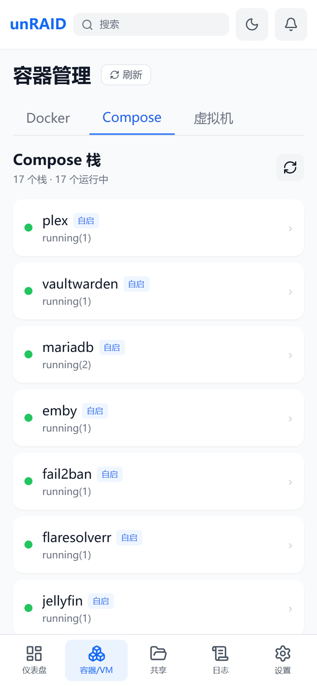
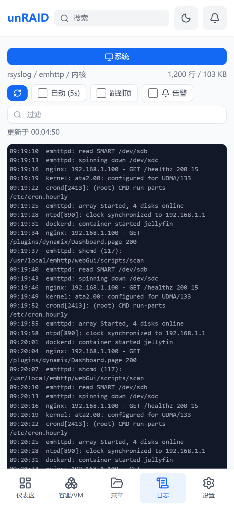
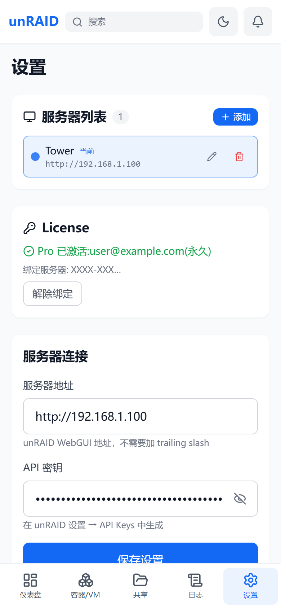

# unRAID Mobile

**[English](README.md)** | 简体中文

[](https://t.me/+l1iA02ZkOK1lNmEx)
[](https://testflight.apple.com/join/c9apZvbG)
[](https://hub.docker.com/r/bear0328/unraid-mobile)
[](https://hub.docker.com/r/bear0328/unraid-mobile)

专为移动设备优化的 unRAID 服务器管理界面。React 18 + TypeScript + Vite + Tailwind CSS,
单容器部署,数据走 unRAID GraphQL API(7.2+;磁盘休眠图标和网络速率统计需要
unRAID 7.3+ / unraid-api ≥ 4.20,老版本会自动降级,仅缺少这两项,其余功能正常)。

## 界面截图

| 仪表盘 | 容器 / VM | Compose 栈 |
|---|---|---|
|  |  |  |

| 共享文件 | 日志 | 设置 / License |
|---|---|---|
|  |  |  |

## 功能(免费版 / Pro)

| 免费版(开箱即用) | Pro(License key 解锁) |
|------|------|
| 仪表盘全部监控:CPU / 内存 / 网络 / 磁盘 / 阵列 / parity 校验进度 / 历史曲线 / 收藏、unRAID 告警徽章 | 容器 / VM 启停 / 重启 / 暂停 / 恢复操作、**VM 增强详情**¹(CPU/内存/磁盘/网络/直通/快照,读 libvirt XML) |
| 容器 / VM 列表、容器详情(端口/挂载/网络/磁盘占用)、容器日志、VM 基础详情 | **Compose 栈管理**(列表/日志/up/down/pull/rebuild/yaml 编辑)¹、**插件管理**(检查/安装/更新/卸载,原生端)¹ |
| 存储页容量与用量条、Shares 文件浏览 / 下载 / 图片预览、磁盘/缓存池只读浏览、宿主系统日志(syslog) | **CPU 温度**¹(直读 /sys/class/hwmon,不唤盘)、Shares 写操作(上传/新建/删除/重命名/文本编辑) |
| 全局搜索、命令面板、配置备份/导入、单服务器、深色主题、PWA | **容器一键更新**(单个/批量,webGui 同款)、**UPS 监控**(电量/续航/负载)、容器批量操作、告警通知(Webhook)、磁盘清理 |

¹ 依赖宿主后端(compose-api)——需按下方「Pro 宿主后端」一节在 unRAID 宿主安装小组件,
**安装会修改开机脚本 `/boot/config/go`,请先知悉其中的风险说明**。免费版无需安装任何东西。

**宿主后端依赖原则**:Compose 管理 / CPU 温度均依赖宿主 `api.php`
(安装到 `/boot/config/plugins/unraid-mobile/`),此类功能均为 Pro。

Pro 为**买断制**:一次付费永久使用(含 1 年更新)。在「设置 → License」输入 key 即解锁。
2026-11-18 起旧格式 key 全部停用，需重新签发。新 key 在首次激活时需联网自动绑机，仅上传 key 与
flashGuid 的 SHA-256 哈希，不上传完整 key、原始 GUID 或邮箱。购买渠道见 GitHub Releases / 后续公告。

## 告警通知(Webhook)

「设置 → Webhook 通知」可把服务器事件推送到 **Bark / Telegram / Discord / 飞书(自定义机器人,
支持签名校验)/ Email(Resend)/ 自定义 HTTP**。事件源按需开启(默认仅容器停止):

- 状态变化:容器停止、VM 停止、UPS 市电变化/电池低电、奇偶校验开始/结束(有同步错误升级
  error)、磁盘状态异常、阵列启停
- 阈值告警(带迟滞 + 冷却):CPU 占用、内存占用、CPU 温度(Pro)、磁盘温度、UPS 低电量
- 其他:**unRAID 原生告警转发**(系统通知中心 ALERT/WARNING,含 SMART 等)、日志关键字命中

磁盘类事件沿用 30 分钟磁盘缓存节拍,不会因监控额外唤醒休眠盘。消息模板变量:
`{{container}} {{state}} {{server}} {{time}} {{category}}`。

## 快速开始（Compose）

> 只使用一份 Compose、一个应用镜像和一个常驻容器。容器不持有宿主特权，也不会自动安装
> Unraid 插件或修改宿主文件；Pro 宿主后端需按下文单独引导。

```bash
mkdir -p /mnt/user/appdata/unraid-mobile/compose/secrets
cd /mnt/user/appdata/unraid-mobile/compose
curl -fsSL -O https://raw.githubusercontent.com/bear0328/unraid-mobile-compose/master/docker-compose.yml
curl -fsSL -o .env https://raw.githubusercontent.com/bear0328/unraid-mobile-compose/master/.env.example
# 编辑 .env:填写 UNRAID_UPSTREAM / UNRAID_SERVER_URL
```

用不回显、不写 shell history 的方式创建两个 secret 文件：

```bash
read -r -s -p 'WebDAV password: ' SECRET; echo; printf '%s' "$SECRET" > secrets/dav_password
read -r -s -p 'Syslog password: ' SECRET; echo; printf '%s' "$SECRET" > secrets/log_password
unset SECRET
chmod 600 .env secrets/*
docker compose up -d
docker compose logs unraid-mobile
```

打开 `http://<unraid-IP>:3999`，在设置页填写 unRAID API key 和相同的 WebDAV/日志密码。
API key 只保存在当前浏览器或原生设备中，不作为 Compose secret 下发；secret 文件由用户持有且权限为 600。
主容器仅在启动时生成或校验 bcrypt 认证文件，已有 `settings.json` 不会被覆盖。免费版到此即可使用；
需要 Compose 管理等 Pro 宿主功能时，再执行下方 `bootstrap-host.sh`。

## 仅基础功能：docker run

```bash
docker run -d \
  --name unraid-mobile \
  -p 3999:80 \
  -e UNRAID_UPSTREAM=http://192.168.1.100:8001 \
  -v /mnt/user/appdata/unraid-mobile/config:/usr/share/nginx/html/config \
  bear0328/unraid-mobile:latest
```

`UNRAID_UPSTREAM` 填你的 unRAID webGui 地址(不带尾部斜杠)——容器内 nginx 把 `/graphql`
反代到这里。**填错则全部 API 请求 502。**

打开 `http://<unraid-IP>:3999`,进「设置」页填:

1. **服务器地址** — 如 `http://192.168.1.100`(填 unRAID webGui 地址,不带尾部斜杠)
2. **API 密钥** — unRAID GraphQL API key(webGui → Settings → API Keys 生成)

> apiKey 只存在你自己浏览器的 localStorage,**不会**写到服务器任何文件。

镜像 tag:`latest`(最新稳定) / `1.3.8`(固定版本)。仅 linux/amd64(unRAID 平台)。

### 可选：unRAID Docker UI 模板

不习惯命令行的话,可以用模板 [`templates/unraid-mobile.xml`](templates/unraid-mobile.xml)
在 Docker 标签页里填表部署:

```bash
# 在 unRAID 宿主上以 root 执行
curl -fsSL -o /boot/config/plugins/dockerMan/templates-user/my-unraid-mobile.xml \
  https://raw.githubusercontent.com/bear0328/unraid-mobile-compose/master/templates/unraid-mobile.xml
```

然后:Docker 标签页 → **Add Container** → 模板下拉选 **unraid-mobile** →
填 `UNRAID_UPSTREAM` → Apply。文件管理/日志/Compose 等可选挂载在高级区,
不需要的行删掉即可。

### 功能 ↔ 挂载对照表

基础功能(仪表盘/容器/VM/设置)**零挂载可用**。进阶功能按需加挂载:

| 功能 | 挂载 / 依赖 | 说明 |
|------|------------|------|
| 配置持久化 | `-v .../config:/usr/share/nginx/html/config` | 只存 serverUrl,建议加 |
| 文件管理 | `-v /mnt/user:/mnt/user` + `-v /mnt/cache:/mnt/cache` + WebDAV 密码文件 | 密码在设置页输入,与 nginx `.davpasswd` 一致 |
| 磁盘/缓存池只读浏览(存储 → 硬盘) | `-v /mnt:/mnt:ro` | 只读;新加盘/池需 recreate 容器才可见 |
| 宿主系统日志 | `-v /var/log:/hostlog:ro` + 日志密码文件 | 同上,`.logpasswd` |
| Compose 栈管理 / CPU 温度(Pro) | `-v /var/run/php-fpm.sock:/hostrun/php-fpm.sock` + 宿主后端 | 见下节 |

完整 Compose 以 [`docker-compose.yml`](docker-compose.yml) 为唯一来源，默认启用上述挂载；不再在文档复制第二份示例。
当前版本只支持单服务器，始终只运行 `unraid-mobile` 一个常驻应用容器；License 服务是独立项目，不在此 Compose 内。

## Pro 宿主后端(compose-api):Compose / 插件管理 / CPU 温度

Compose、`docker run` 和 Docker UI 模板都只负责应用容器，不会自动安装本节后端。需要这些 Pro 功能时，
在 Unraid 宿主上显式执行下面的 `bootstrap-host.sh`；它会先校验 GraphQL 与 API key，再调用既有幂等安装器。

Compose、插件管理和 CPU 温度(均为 Pro 功能)依赖一个宿主端小组件(`api.php`,经宿主 php-fpm
以 root 执行 `docker compose` / 官方 `plugin` CLI / 直读 `/sys/class/hwmon`)。
未安装时对应功能显示安装指引或占位,**其余功能不受影响**。

Web 与原生端支持 Community Applications 搜索、分类、详情、HTTPS `.plg` 插件安装及官方 Docker 模板安装。
所有插件任务在宿主后台串行执行并保留日志。插件作者提供的脚本会以 root 运行;只安装可信来源,
卸载及配置清理由插件自身定义。Unraid OS 更新不在此功能范围内。

> ⚠️ **风险说明(安装前必读)**
> 安装脚本会修改以下持久宿主文件(unraid-mobile 自身改动带【unraid-mobile】标记):
> - `Compose Manager Plus`:未安装时从作者官方仓库的固定提交安装;插件自身文件和配置由该插件管理
> - `/boot/config/go`:开机脚本,追加恢复钩子(6 行),用于重启后恢复 Pro 后端组件、清理 Compose 残留锁
> - `/boot/config/plugins/unraid-mobile/api.php`:Pro 后端(Compose / CPU 温度 / VM 详情)flash 正本
> - `/boot/config/plugins/unraid-mobile/plugin-worker.php`:插件后台任务 worker flash 正本
> - `/boot/config/plugins/unraid-mobile/update-status.php`:Compose 更新徽章回写脚本 flash 正本
> - `/boot/config/plugins/unraid-mobile/apikey`:API key 的 sha256 哈希(明文不落 flash;FAT 权限由挂载选项控制)
> - `/boot/config/plugins/unraid-mobile/audit.log`:api.php 关键操作审计日志
> - `/boot/config/go.unraid-mobile-bak`:安装前自动备份的 `go` 文件
>
> 保障措施:
> - 修改前自动备份 `/boot/config/go` 为 `/boot/config/go.unraid-mobile-bak`
> - 仅追加带【unraid-mobile】标记的恢复钩子,不改动你已有的任何行
> - 脚本执行时会要求输入 `YES` 显式确认
> - 卸载后端:删除 `/boot/config/plugins/unraid-mobile/` 和 `go` 里标记的恢复钩子;如不再需要本次自动安装的 Compose Manager Plus,需在 Unraid 插件管理中单独卸载
>
> 如果你不接受对开机脚本的任何修改,不要安装 —— 免费版的全部功能都不需要它。

免费版无需任何第三方 Unraid 插件。Pro 宿主后端只额外依赖 **Compose Manager Plus**
(内部插件 ID 仍为 `compose.manager`,与旧版共用目录);
**不需要先安装 Community Applications 或 User Scripts**。下面的命令会在 Unraid 上创建私有临时目录，
下载宿主 bootstrap 和既有安装器；其余后端文件由安装器自动下载，其中 `api.php` 和 `plugin-worker.php` 会做 SHA-256 校验：

```bash
# 在 Unraid 机器的 SSH/终端中以 root 执行
um_install_dir="$(mktemp -d /tmp/unraid-mobile-install.XXXXXX)" \
  && mkdir -p "$um_install_dir/scripts" "$um_install_dir/compose-api" \
  && curl -fsSL -o "$um_install_dir/scripts/bootstrap-host.sh" \
    https://raw.githubusercontent.com/bear0328/unraid-mobile-compose/v1.5.14/scripts/bootstrap-host.sh \
  && curl -fsSL -o "$um_install_dir/compose-api/install-compose-api.sh" \
    https://raw.githubusercontent.com/bear0328/unraid-mobile-compose/v1.5.14/compose-api/install-compose-api.sh \
  && bash "$um_install_dir/scripts/bootstrap-host.sh"
```

bootstrap 默认通过 `http://127.0.0.1/graphql` 校验 API key；如本机 GraphQL 使用其他地址，追加
`--upstream http://127.0.0.1:8001`。校验通过后才会进入安装器：风险确认(输 YES)→ 检测 compose.manager
(**Plus 或兼容旧版已安装均跳过**；缺失时通过 Unraid 官方 `plugin` 命令从作者仓库安装 Compose Manager Plus)
→ 将 apiKey 以 `sha256:` 哈希写入 `/boot/config/plugins/unraid-mobile/apikey`(明文不落 flash 盘)
→ 装 api.php 到 Compose Manager Plus 插件目录 → 备份并加 `/boot/config/go` 恢复钩子。
可重复执行，不会重复安装已有插件。`--local-only` 用于离线恢复，此时缺少 Compose Manager Plus 会中止并提示手动安装。

Compose 已默认挂载 php-fpm.sock；使用 `docker run` 或自定义模板时需自行添加该挂载并重建容器，
Compose tab 与 CPU 温度(Pro 激活后)即可用。

### 后续升级

- Docker 容器与宿主后端是两个独立组件。原生 App 可在「容器 → unraid-mobile → 更新镜像」更新容器；设置页显示的 `appVersion` 是当前宿主 `api.php` 版本，不代表镜像已经更新。
- 自 v1.5.11 起，Pro 用户可在原生 App 或 Web 的「设置 → 关于」直接同步宿主后端。同步仅使用官方部署仓固定版本发布包，全文件 SHA-256 校验通过后才安装，并保留现有 API Key 哈希与 License 凭证。
- 任务由独立宿主后台 worker 执行，断线后按请求 ID 恢复；安装前备份管理文件，安装或版本复核失败会尝试回滚。此入口不允许降级。
- **首次安装仍必须在 Unraid 网页终端或 SSH 以 root 执行上述命令。v1.5.10 及更早后端不认识同步接口，需要最后手动升级一次到 v1.5.11，之后版本才能直接页内同步。**

## 从源码构建

```bash
git clone https://github.com/bear0328/unraid-mobile.git
cd unraid-mobile
npm ci
npm run build        # 产物在 dist/
npm test             # vitest
docker build -t unraid-mobile .
```

## unRAID GraphQL API 限制说明

### Docker 容器
| 功能 | 支持 | 字段 |
|------|------|------|
| 列表 | ✅ | id, names, image, state, status, autoStart, created |
| 日志 | ✅ | logs(tail) { lines { timestamp, message } } |
| 统计 | ✅ | stats { cpuPercent, memUsage, memPercent }(订阅) |
| 启停 | ✅ | mutation |
| 普通容器参数编辑 | ✅(Pro) | 原生 iOS；compose-api 编辑 Unraid 用户模板并通过官方 `xmlToCommand` 重建 |
| 端口映射 / 挂载 / 网络 / 磁盘占用 | ✅ | ports / mounts / networkSettings / size*(详情查询) |

### 虚拟机
| 功能 | 支持 | 字段 |
|------|------|------|
| 列表 | ✅ | domains { name, uuid, state } |
| 启停 | ✅ | mutation |
| 静态配置 | ✅(Pro) | compose-api 读取 libvirt XML：vCPU/内存分配/磁盘/网络/直通/快照/固件 |
| 实时性能 / QEMU 日志 | ✅(Pro) | compose-api 读取 libvirt domstats 原始计数器与 QEMU/libvirt 日志；仅单 VM 详情按需采样 |

## 更新日志

完整历史见 [CHANGELOG_CN.md](CHANGELOG_CN.md)。

### TestFlight 2.0.0(157)(2026-11-28)

- 宿主后端手动升级改为一个「复制升级命令」按钮，使用全新临时目录和固定版本安装器，保留 API Key，避免重复安装旧版
- Docker 更新直接引导到 App 容器详情；与 Web/Docker、compose-api v1.5.14 协调发布，完整 XCTest 961/961 通过

### v1.5.14(2026-11-28)

- App 与 Web 提供一键复制的手动宿主升级命令，使用全新临时目录和固定版本安装器，避免复用旧 installer 中的 `api.php`
- compose-api 仅将 `APP_VERSION` 更新为 1.5.14，无新增宿主功能；v1.5.13 宿主可页内同步升级

### TestFlight 2.0.0(156)(2026-11-28)

- 统一原生播放器顶部/底部控制层与加载、错误状态，媒体摘要更紧凑，主按钮更清晰；新增左右双击 ±15 秒、首帧超时保护，自动续播后可直接从头开始
- 字幕/音轨改为播放中也能滚动的独立面板；重试保留当前会话进度，长按结束恢复倍速，横屏跟随实际窗口；WebDAV、STRM、Emby、Jellyfin 共用统一来源加载器
- 仅原生 App 更新；Web、Docker 和 compose-api 保持 v1.5.13，无需重跑安装脚本。原生 XCTest 960/960 全部通过

### TestFlight 2.0.0(155)(2026-11-28)

- 「共享」页签统一改名为「存储」，共享与硬盘列表新增备注、完整容量信息和用量条，分类与全局搜索文案同步调整
- 增加首载骨架屏、旧数据刷新失败警告与重试、缓存池部分失败提示；旧快照保持兼容，共享与缓存池并行加载且不新增轮询
- 仅原生 App 更新，Web、Docker 和 compose-api 仍为 v1.5.13，无需重跑安装脚本；完整 XCTest 952/952 通过

### TestFlight 2.0.0(154)(2026-11-28)

- 媒体库卡片图片统一为 16:9 横向布局，修正图片溢出与卡片遮挡；完整 XCTest 948/948 通过

### TestFlight 2.0.0(152)(2026-11-28)

- 媒体库改为横向滑动海报行，与继续观看/新增内容完全一致（图片纵向 2:3，排布横向，宽度 116）
- 修复 autoindex 页面截断 UTF-8 字符导致的解析异常
- 仅原生 App 更新，Web、Docker 和 compose-api 仍为 v1.5.13，无需重跑安装脚本；完整 XCTest 948/948 通过

### TestFlight 2.0.0(151)(2026-11-28)

- 媒体库临时改为竖排列表（后续 152 恢复为横向海报行）
- 仅原生 App 更新，Web、Docker 和 compose-api 仍为 v1.5.13，无需重跑安装脚本；完整 XCTest 948/948 通过

### TestFlight 2.0.0(150)(2026-11-28)

- 媒体库首次尝试海报卡片布局，宽度偏大导致重叠（后续 152 修正为 116）
- 更新 TestFlight 应用描述，完整区分免费版与 Pro 功能
- 仅原生 App 更新，Web、Docker 和 compose-api 仍为 v1.5.13，无需重跑安装脚本；完整 XCTest 948/948 通过

### v1.5.13(2026-11-27)

- 将确认的橙色品牌设计统一应用到原生 App、Web/PWA、Capacitor 启动图和公开部署仓，并按各平台原生方式呈现圆角
- 继续观看改为每部剧一张卡片，保留最近可续播单集，使用剧集海报并支持直接续播；电影保持独立展示
- 与 TestFlight 2.0.0(149) 协调发布。compose-api 仅将 `APP_VERSION` 更新为 1.5.13，无新增宿主功能；v1.5.12 宿主可页内同步升级

### TestFlight 2.0.0(149)(2026-11-27)

- 继续观看按最近播放顺序将同一部剧归并为一张卡片，显示剧名、剧集海报和单集信息，点击直接续播最近一集
- AppIcon 更新为确认的橙色设计与 iOS 原生连续圆角；完整 XCTest 948/948 通过

### TestFlight 2.0.0(148)(2026-11-27)

- 播放器首页补齐“继续观看”和“新增内容”本地快照；打开页签先显示媒体库、首页和海报缓存，再后台刷新。断网或刷新失败保留旧内容，缓存按服务器与用户隔离，不缓存影片文件、API Key 或媒体路径
- 仅原生 App 更新，Web、Docker 和 compose-api 仍为 v1.5.12，无需重跑安装脚本；完整 XCTest 946/946 通过

### TestFlight 2.0.0(147)(2026-11-27)

- 总览普通刷新收敛为导航栏唯一可见入口，保留下拉刷新；移除服务器卡片重复按钮和持续跳动的相对时间，仅在刷新失败、仍展示旧数据时显示上次成功更新时间
- 仅原生 App 更新，Web、Docker 和 compose-api 仍为 v1.5.12，无需重跑安装脚本；完整 XCTest 944/944 通过

### TestFlight 2.0.0(146)(2026-11-27)

- 修复播放过程中退到后台或系统结束进程时，VLC 销毁阻塞主线程并触发 `0x8BADF00D` 看门狗强杀的问题；旧播放器改由专用串行后台队列释放，不改变后台音频行为
- 仅原生 App 更新，Web、Docker 和 compose-api 仍为 v1.5.12，无需重跑安装脚本；完整 XCTest 944/944 通过，真实 iPhone 原场景仍需在 146 中复验

### v1.5.12(2026-11-27)

- 原生设置重组为 7 组，统一 Pro 与凭据流程，提供独立宿主后端状态、绑定验证快照的连接测试、可核验的 Keychain 操作和事务式配置恢复；轮询与外观偏好纳入自动备份
- nginx `/config/` 仅公开精确 `settings.json` 的 GET/OPTIONS，其余配置（含 License 记录与 `app-backup`）默认要求 DAV 鉴权。备份包含秘密，受 WebDAV 鉴权保护，而非加密保护
- 与 TestFlight 2.0.0(145) 协调发布。compose-api 仅将 `APP_VERSION` 更新为 1.5.12，无新增宿主功能；v1.5.11 宿主可页内同步升级，无需手工重跑安装脚本

### TestFlight 2.0.0(145)(2026-11-27)

- 设置重组为 7 组，统一 Pro 入口和凭据保存/验证/清除流程，宿主后端控制与状态迁入独立子页
- 新增绑定验证快照的连接测试、Keychain 写入/删除读回核验与失败恢复、完整恢复预检、事务提交/回滚、非法版本/ID/URL 拒绝与安全缓存路径，并自动备份轮询/外观偏好
- 完整 XCTest 943/943、最新专项 59/59、Vitest 1951/1951 及模拟器浅色/深色/大字体检查通过；真实设备交互仍由用户验收

### TestFlight 2.0.0(144)(2026-11-27)

- 新增内容中的同一部剧只显示一张剧集卡片，不再逐集列出；按最新单集的添加时间排序，点击卡片进入该剧选择季和单集，电影仍独立显示
- 仅原生 App 更新，Web、Docker 和 compose-api 仍为 v1.5.11，无需重跑安装脚本；缺少所属剧集信息的异常单集不会单独占用卡片

### TestFlight 2.0.0(143)(2026-11-27)

- 新增内容中的单集不再优先使用视频帧截图，改为优先显示剧集海报，缺失时回退到季海报；电影和剧集条目继续使用自身海报
- 仅原生 App 更新，Web、Docker 和 compose-api 仍为 v1.5.11，无需重跑安装脚本；继续观看仍保持季海报优先、剧集海报兜底

### TestFlight 2.0.0(142)(2026-11-27)

- 原生播放器首页按「媒体库 → 继续观看 → 新增内容」三模块排列，均支持横向滑动；媒体库只保留入口，点击后浏览库内内容
- 新增内容跨媒体库按添加时间合并排序并去重，不再按媒体库拆行；继续观看的单集优先使用季海报或剧集海报，避免把视频帧作为海报
- 仅原生 App 更新，Web、Docker 和 compose-api 仍为 v1.5.11，无需重跑安装脚本；真实服务器首页布局与海报回退仍需真机验收

### v1.5.11(2026-11-27)

- 原生 App 与 Web 设置页支持 Pro 宿主后端同步，使用官方固定版本发布包、全文件 SHA-256 校验、安装前备份和失败回滚，保留 API Key/License 凭证并支持请求 ID 恢复
- Web 激活异常现在显示明确错误并始终结束「验证中」；宿主授权同步失败可直接跳转宿主后端同步入口
- 与 TestFlight 2.0.0(141) 协调发布；首次安装仍需 root，v1.5.10 及更早宿主后端需最后手动升级一次到 v1.5.11

### TestFlight 2.0.0(141)(2026-11-27)

- 新增原生 Pro 宿主后端同步，支持进度日志、断线恢复、明确回滚结果，以及无法确认结果时的中性提示
- 设置页明确 `appVersion` 是宿主后端版本而非 Docker 镜像版本；与 Web/Docker、compose-api v1.5.11 协调发布

### TestFlight 2.0.0(140)(2026-11-27)

- 新增后台音频与独立音频会话管理，支持来电/Siri 中断恢复、耳机拔下暂停、路由变化处理，以及锁屏和控制中心播放控制
- 新增 WebDAV 当前目录与 Emby/Jellyfin 当前已加载音频的音乐队列，支持顺序/随机、列表/单曲循环、上一首/下一首、自动连播、断点续播和 Emby/Jellyfin 进度上报
- 视频仍使用原播放页与原始质量 Direct Play，不增加自动转码；切歌时旧曲与新曲的进度保存和播放上报相互隔离
- 仅原生 App 更新，Web、Docker 和 compose-api 仍为 v1.5.10，无需重跑安装脚本。本次不包含画中画，后台、中断、路由和队列仍需真机验收

### TestFlight 2.0.0(139)(2026-11-27)

- 原生 Emby/Jellyfin 媒体中心改版，新增继续观看、各库最新内容、海报/列表布局、海报缓存与相互隔离的离线目录快照；缓存不包含媒体路径或远程 STRM 源
- Direct Play 的播放与上报固定使用同一媒体源，支持明确重试和手动选择其他原画源；远程错误页与源站故障不再误报为解码失败，不增加自动 Remux 或转码
- 锁屏与控制中心支持海报、进度、播放/暂停、前后 15 秒及可跳转媒体的进度控制；画面锁定也会禁用系统控制。本次不包含后台音频、画中画或音乐队列
- 仅原生 App 更新，Web、Docker 和 compose-api 仍为 v1.5.10，无需重跑安装脚本

### v1.5.10(2026-11-27)

- 应用商店的 Docker 已安装状态只认当前实际容器，运行/停止均算；用户模板残留与社区模板不再造成误报，插件判定不变
- 原生播放器同步修复弱网进度上报、远程媒体大响应探测与跨源凭据转发，并移除容器概览的重复商店入口
- 与 TestFlight 2.0.0(138) 协调发布；**升级后需重跑宿主安装脚本**以部署新版 compose-api

### v1.5.9(2026-11-23)

- 原生一键更新覆盖普通 Docker、compose.manager 栈与外部 Compose 项目，更新前提供分类名单，同一 Compose 项目保留原配置且只更新一次
- 新增安全的外部 Compose 发现、项目级异步任务、请求 ID 恢复、进度日志和更新徽章即时刷新；外部 Compose 绝不降级为普通容器更新
- 与 TestFlight 2.0.0(137) 协调发布；**升级后需重跑宿主安装脚本**以部署新版 compose-api 接口

### v1.5.8(2026-11-23)

- 兼容 Unraid 7.4 的 `flashGUID` 与旧版 `flashGuid` 字段，修复 Pro 校验读取本机标识失败导致容器「更新全部」等操作被中断的问题
- 仅 compose-api 后端修复，绑机哈希与 License 规则不变，原生 App 功能无变化；**升级后需重跑宿主安装脚本**

### v1.5.7(2026-11-23)

- GPU 指标采用 4 秒共享缓存，避免随 1 秒轮询反复启动外部采样命令；CPU 功耗和内存仍实时读取，Web 容器摘要同步去除重复计数
- 与 TestFlight 2.0.0(135) 协调发布；**升级后需重跑宿主安装脚本**以部署新版 compose-api

### TestFlight 2.0.0(135)(2026-11-23)

- 总览新增下拉刷新，普通刷新不读取磁盘详情或主动唤醒休眠盘；磁盘卡未加载时提供说明和“获取磁盘详情”入口
- 与 Web/Docker v1.5.7 协调发布；**升级后需重跑宿主安装脚本**以启用 GPU 采样优化

### v1.5.6(2026-11-23)

- 普通 Docker 更新新增请求 ID、幂等恢复、身份/Compose/模板复核与进程组异常锁回收；无法确认的结果明确返回 `unknown`
- 与 TestFlight 2.0.0(133) 协调发布；**升级后需重跑宿主安装脚本**以部署新版 compose-api

### TestFlight 2.0.0(133)(2026-11-23)

- 统一详情、多选和一键更新的 Compose 归属；容器列表先显示再并行回填更新与图标，补齐稳定排序、真实筛选、CA 入口和编辑限制说明
- 日志支持 cursor 降级、前后台恢复和 3000 行上限；更新响应丢失只按原请求 ID 恢复，不重复执行，并以中性“结果待确认”呈现未知结果
- 与 Web/Docker v1.5.6 协调发布；**升级后需重跑宿主安装脚本**

### v1.5.5(2026-11-23)

- Web 容器页改为显式多选，统一加载骨架、筛选空态、缓存错误与长文本布局，更新任务准确区分成功、部分完成和失败
- 与 TestFlight 2.0.0(132) 协调发布；**升级后需重跑宿主安装脚本**以同步 compose-api 发布版本元数据

### TestFlight 2.0.0(132)(2026-11-23)

- 保留容器/Compose 栈/虚拟机选择菜单，修复 iOS 26 多选操作栏与悬浮 Tab 栏叠层，以及筛选无结果提示被遮挡的问题
- 优化缓存错误、Compose 长文本、VM UUID、更新结果与失败明细展示，并遵循系统“减少动态效果”设置
- 与 Web/Docker v1.5.5 协调发布；**升级后需重跑宿主安装脚本**以同步 compose-api 发布版本元数据

### v1.5.4(2026-11-23)

- 修复搜索隐藏项仍参与批量操作、Docker 自启动/创建时间丢失、stats 失败后无法恢复、并发行操作 loading 互相覆盖，以及实时日志重复请求和旧会话写入
- 新增 URL 同步的可访问页签、独立 Docker/VM 新鲜度、清晰的空态/加载态、安全区适配的批量控件与更大触控区域，并优化元数据加载和日志渲染
- 仅 Web/Docker 界面更新，原生 App 功能不变；**升级后需重跑宿主安装脚本**以同步 compose-api 发布版本元数据

### TestFlight 2.0.0(128)(2026-11-22)

- 「设置 → 关于」明确区分 **unRAID-Mobile App** 与 **unRAID-Mobile Docker**，分别显示两个版本，Docker/后端落后时提示“可升级”
- 手动说明覆盖更新容器、重跑宿主安装脚本和刷新确认；旧版无版本字段、网络失败及后端比 App 新时均不会误报升级或降级
- 与 Web/Docker v1.5.3 和 compose-api 协调发布，**升级后需重跑宿主安装脚本**

### v1.5.3(2026-11-22)

- Web 与原生「关于」分别显示 App 和 Docker/宿主后端版本，后端落后于 App 配套版本时提供清晰的手动升级步骤
- compose-api 的 `capabilities` 新增 `appVersion`；发布脚本自动同步后端、package 与原生配套版本号
- Web、TestFlight 2.0.0(128) 和 compose-api 需协调升级，**升级后需重跑宿主安装脚本**

### TestFlight 2.0.0(127)(2026-11-22)

- 修复 Emby 剧集的本地 0 进度遮住服务器续播位置、导致不显示「继续播放」的问题；有效服务器进度现在提供「继续播放 / 从头开始」，有效本地记录仍优先
- 续播选择完成前不启动进度上报，避免起播 0 进度清除服务器记录；播放、拖动、暂停和关闭时同步进度，退出播放后刷新媒体列表
- 仅原生 App 更新，Web、Docker 和 compose-api 无变化，无需重跑安装脚本

### TestFlight 2.0.0(126)(2026-11-22)

- License 增加本机 compose-api 二次验签和绑机凭证；完整 Key 只发送到用户自己的 Unraid 后端，中心仍只接收 SHA-256 哈希。首次激活仍需中心联网绑机，本机同步失败不阻断其他 Pro 功能
- 容器、VM 和 Parity 操作补齐界面与 Store 双层 Pro 门控；Keychain 保存失败不再误报激活成功，Docker 更新遇到不确定错误不再重复执行
- 与 Web/Docker v1.5.2 和新版 compose-api 协调发布，**升级后需重跑宿主安装脚本**；旧客户端访问新版后端 Pro 路由会返回 403

### v1.5.2(2026-11-22)

- compose-api 对 Pro 路由增加本机 ECDSA 验签、有效期和绑机凭证校验；首次在新后端建立凭证需联网，之后可离线验证，中心服务仍只保存哈希
- Web 激活失败恢复原授权，本机后端暂不可用不阻断其他 Pro 功能；单个 Docker 更新不再因超时、网络错误或 403/502/503 重复执行 GraphQL
- Web、TestFlight 2.0.0(126) 和 compose-api 需协调升级，**升级后需重跑宿主安装脚本**

### TestFlight 2.0.0(125)(2026-11-22)

- 针对部分真机在 124 中 TS 跳转后仍停在目标首帧、声音继续的问题：异常片源可能存在较大的 PTS/DTS 重排差，TS 的 avformat/软解链路现在允许输出跳转后被判迟到的视频帧，避免持续丢弃已解码画面
- 保留 124 的 TS 播放器与画布重建行为；MP4、MKV 等其他容器不改变视频输出策略，仍使用原地 seek
- 仅原生 App 更新，Web、Docker 和 compose-api 无变化，无需重跑安装脚本

### TestFlight 2.0.0(124)(2026-11-22)

- 针对部分真机在 123 中 TS 跳转后仍停在目标首帧、声音继续的问题，avformat/软解链路现在会同时销毁并重建整个 VLC 播放器与视频画布，并隔离旧播放器的延迟回调，不再只替换媒体输入
- TS 跳转后继续保留播放/暂停状态、音轨、字幕轨、外挂字幕、倍速和字幕延迟；MKV、MP4 等其他容器仍使用原地 seek
- 仅原生 App 更新，Web、Docker 和 compose-api 无变化，无需重跑安装脚本

### TestFlight 2.0.0(123)(2026-11-22)

- 针对 TS 跳转后音频继续、画面卡住的问题，TS 的 avformat/软解链路改为从目标时间重新打开媒体输入，重建解复用、解码与视频输出；保留播放/暂停状态、音轨、字幕轨和外挂字幕，MKV、MP4 等其他容器仍使用原地 seek
- 仅原生 App 更新，Web、Docker 和 compose-api 无变化，无需重跑安装脚本

### TestFlight 2.0.0(122)(2026-11-22)

- 针对部分真机播放远程 Emby/STRM MPEG-TS 时进度条继续前进、画面却冻结的问题，TS 的 FFmpeg 解复用链路改用软件解码，避开 VideoToolbox 硬解输出兼容问题；MKV、MP4 等其他容器保持原解码路径
- 仅原生 App 更新，Web、Docker 和 compose-api 无变化，无需重跑安装脚本

### TestFlight 2.0.0(121)(2026-11-22)

- 原生播放器新增 Jellyfin，与 Emby 共用现有播放器；在「设置 → 媒体服务器」选择服务类型后，可浏览媒体库与海报、切换用户、原始流 Direct Play、续播并回传播放进度
- Jellyfin 的 API、海报和 VLC 播放请求均使用所需的 MediaBrowser 鉴权，包含后续 Range/seek；保留反向代理子路径，远程 STRM 源不会收到媒体服务器 API Key
- 现有 Emby 配置、钥匙串凭据和本机续播记录保持兼容；仍不包含服务端转码。仅原生 App 更新，Web、Docker 和 compose-api 无变化，无需重跑安装脚本

### TestFlight 2.0.0(120)(2026-11-22)

- 修复部分远程 Emby/STRM MPEG-TS 视频只显示首帧、随后卡住或提前结束的问题；识别为 TS 的片源改用 VLCKit 的 FFmpeg 解复用器，兼容无扩展名和通用 MIME 的 CDN 地址，无需转码，也不改变 MKV/MP4 播放路径
- 已知片长的视频若明显提前结束，现在会显示可重试的播放错误，不再静默表现为播放完成
- 仅原生 App 更新，Web、Docker 和 compose-api 无变化，无需重跑安装脚本

### TestFlight 2.0.0(119)(2026-11-21)

- 排序字段与方向按 Emby 服务器、用户和目录独立保存，媒体库、剧集和季目录不再互相覆盖，切换页面或重启后恢复各自选择
- 剧集和季目录默认按季数/集数升序排列，避免按标题造成集数乱序；仍可按目录改选其他排序并单独记忆
- 仅原生 App 更新，Web、Docker 和 compose-api 无变化，无需重跑安装脚本

### TestFlight 2.0.0(118)(2026-11-21)

- 剧集列表和播放标题显示季/集序号，如 `S01E03 · 剧集名称`；特别篇支持 `S00`，缺少序号时保留原名称
- 排序字段与升降序按 Emby 服务器和用户保存，切换目录、页签或重启 App 后自动恢复
- 仅原生 App 更新，Web、Docker 和 compose-api 无变化，无需重跑安装脚本

### TestFlight 2.0.0(117)(2026-11-21)

- Emby 服务器编辑页底部新增常驻红色「删除服务器」按钮，不再只依赖列表左滑；点击后需二次确认，只删除 App 内配置与本机 API Key，不影响 Emby 服务端
- 仅原生 App 更新，Web、Docker 和 compose-api 无变化，无需重跑安装脚本

### TestFlight 2.0.0(116)(2026-11-21)

- Emby 播放器支持多服务器与每服务器多用户：设置中可添加、编辑和删除服务器，播放器顶部菜单可按服务器分组切换用户并记住上次选择
- 每台服务器的 API Key 独立保存在本机钥匙串；媒体库、海报和播放进度按服务器与用户隔离，切换后旧请求不会覆盖新列表
- 旧单服务器配置、钥匙串凭据和本机续播记录自动兼容迁移；仅原生 App 更新，Web、Docker 和 compose-api 无变化，无需重跑安装脚本

### TestFlight 2.0.0(115)(2026-11-21)

- Emby 媒体库升级为底部独立「播放器」页签，共享页移除重复 Emby 入口；Emby 服务器仍可在设置中配置
- 系统日志迁入「设置 → 日志」，通知详情保留过滤条件直达；筛选、自动刷新、行数档和导出功能不变
- 仅原生 App 更新，Web、Docker 和 compose-api 无变化，无需重跑安装脚本

### TestFlight 2.0.0(114)(2026-11-21)

- 修复 Emby 远程 STRM 电影和剧集黑屏：远程 HTTP 媒体改由 VLCKit 直接播放并携带 User-Agent，避免 Emby 代理上游时只返回错误文本；本地文件仍使用 Emby 直链
- Emby 目录右上角新增名称、添加日期、上映日期、评分及升降序排序，分页加载保持同一排序条件
- 仅原生 App 更新，Web、Docker 和 compose-api 无变化，无需重跑安装脚本

### TestFlight 2.0.0(113)(2026-11-21)

- 新增原生 Emby 播放器：在设置中配置服务器地址、API Key 与媒体库用户，从共享页顶部菜单进入 Emby；API Key 仅保存在本机钥匙串
- 支持媒体库与剧集目录分页浏览、海报、原始流 Direct Play，复用 VLCKit 音轨、字幕、倍速、全屏和锁定控制；读取 Emby 续播位置并回传播放进度
- 仅原生 App 更新，Web、Docker 和 compose-api 无变化，无需重跑安装脚本；当前不包含 Emby 服务端转码

### TestFlight 2.0.0(112)(2026-11-21)

- 容器与共享页恢复系统标准的左侧大标题，分类切换改为顶部独立下拉按钮，修复 111 中标题位置异常和标题菜单无法点击的问题；容器 / Compose 栈 / 虚拟机及共享 / 硬盘切换均已实际点击验证
- 日志页将刷新放入顶部工具栏，自动刷新 / 跳到顶 / 日志告警收进相邻选项菜单，移除常驻控制行；筛选、行数档、导出和告警横幅保持不变
- 仅原生 App 更新，Web、Docker 和 compose-api 无变化，无需重跑安装脚本

### TestFlight 2.0.0(111)(2026-11-21)

- 容器与共享页移除常驻分段栏，改用导航标题下拉菜单，为列表和搜索释放纵向空间；容器页切换容器 / Compose 栈 / 虚拟机，共享页切换共享 / 硬盘
- 标题显示明确的下拉指示，搜索、排序、刷新、批量操作及原有跳转保持不变；仅原生 App 更新，Web、Docker 和 compose-api 无变化，无需重跑安装脚本

### TestFlight 2.0.0(110)(2026-11-21)

- 播放控制栏的视频简易信息新增当前视频轨标称码率，片源未提供时省略，不使用输入或 Demux 总码率代替
- 编码名称简化显示：H.264 不再显示为 `H264 - MPEG-4 AVC (PART 10)`，AAC 不再显示为 `MPEG AAC AUDIO`
- 仅原生 App 更新，Web、Docker 和 compose-api 无变化，无需重跑安装脚本

### TestFlight 2.0.0(109)(2026-11-21)

- 播放器控制栏左下角新增简易媒体信息，展示分辨率、视频编码、帧率和当前音轨的编码、声道、语言及标称码率；缺失字段自动省略，切换音轨后同步更新
- 新增播放控制锁定：锁定后屏蔽进度、播放、设置和关闭等触控，轻点画面仅唤出解锁按钮，5 秒无操作自动隐藏
- 媒体摘要起播后缓存、轨道变化时更新，不随进度高频解析；仅原生 App 更新，Web、Docker 和 compose-api 无变化，无需重跑安装脚本

### TestFlight 2.0.0(108)(2026-11-21)

- 原生播放器新增媒体详情，展示视频编码、分辨率、帧率、标称码率、音轨、字幕轨和实时播放统计；详情面板支持半屏/全屏，窄屏自动收进播放设置菜单
- MobileVLCKit 升级至 3.7.5，包含上游安全与崩溃修复；不包含 4.0 的 Dolby Vision Profile 5 支持，MKV P5 偏色仍需等待后续播放内核支持
- 仅原生 App 更新，Web、Docker 和 compose-api 无变化，无需重跑安装脚本

### v1.5.1(2026-11-21)

- 修复用户 Docker 模板中 `file://` 本地图标被忽略的问题，Unraid Mobile 等容器及对应 Compose 栈可正常显示已有图标
- 本地图标仅限 Unraid 标准 `docker-icons` 目录，经格式与大小校验后通过 API Key 鉴权读取，不暴露宿主路径。compose-api 已更新，**升级后需重跑安装脚本**；无需新原生构建

### v1.5.0(2026-11-21)

- Web 与原生 iOS 的 Docker、Compose 列表和详情统一显示应用图标；自动匹配覆盖用户/社区模板、Community Applications 和 Dashboard Icons，Compose 优先使用同名主容器或主服务图标，避免辅助容器图标错配
- Web 详情新增手工 HTTPS 图标、本地上传 PNG/JPEG/WebP（最大 2MB）和恢复自动匹配；设置保存在 Unraid 并同步到 App，不修改 Docker 模板或 Compose 文件，也不触发容器重建。上传图片通过 API Key 鉴权读取，公网图片请求不会携带密钥
- compose-api 已更新，**升级后需重跑安装脚本**。原生版本为 TestFlight 2.0.0(107)

### v1.4.9(2026-11-20)

- 原生 iOS 新增 Pro 普通 Docker 容器参数编辑，基于 Unraid 用户模板，支持后台进度、秘密保留、运行状态保持、冲突保护和失败恢复
- 已有本地镜像不会被拉取或升级；Compose 成员、无用户模板、Tailscale 专用容器及重命名仍不支持。compose-api 已更新，**升级后需重跑安装脚本**。原生版本为 TestFlight 2.0.0(104)

### v1.4.8(2026-11-19)

- 新增 Web 安全只读文本预览，并扩展 Web 与原生 iOS 的 NFO、字幕、播放列表、图片、音频、视频及 QuickLook 文档格式支持
- Web 视频解码失败与原生 QuickLook 不支持的文档现在都有明确提示和回退处理

### v1.4.7(2026-11-19)

- 单容器升级遇到空占位 secret 时保留已有 DAV/日志 bcrypt 凭据；全新安装仍拒绝空 secret

### v1.4.6(2026-11-19)

- 部署收敛为一份 Compose、一个应用镜像和一个非特权常驻容器；Web 与原生端退役 setup/router 及多服务器功能，备份迁移仅保留 active 配置
- 新增独立幂等 Pro 宿主 bootstrap，并完善媒体预览、中文字幕与文件类型图标

### v1.4.4(2026-11-16)

- 修复 Web 告警弹层标题在已读后仍显示通知总数；标题未读数现在与铃铛角标同步减少

### v1.4.3(2026-11-16)

- Web 告警支持单条及全部已读，角标只统计未读；已读状态按服务器本地保存，数量清零后仍可回看历史告警

### v1.4.1(2026-11-15)

- 单服务器 Compose 默认不再启动或依赖 router；Web 多服务器改用 `multi-server` profile 手动启用，Nginx 在 router 未启动时也能正常运行

### v1.4.0(2026-11-15)

- 全功能 Compose 升级为 `setup + Web + router` 三服务：setup 一次性安装并校验宿主后端，Web 保持非特权，router 仅按白名单转发受控协议；Web 多服务器支持独立 DAV/日志密码，查询、缓存、连接和危险操作均按目标隔离
- compose-api 缺失或临时不可用时容器更新安全回退 GraphQL；修复切机旧响应、统计流和缓存串机，以及带端口 Host 的远端 DAV 改写。未知路由、任意上游、重复地址和缺失凭据全部 fail-closed

### v1.3.33(2026-11-15)

- CA 安装去掉 `$_POST`/`CreateDocker.php` 耦合：CA 模板 XML 直接写为用户模板 `my-<name>.xml`，先 `docker pull` 拿进度再调官方 `update_container` 创建（与容器更新同一路径）。compose-api 已更新，**升级后需重跑安装脚本**

### v1.3.32(2026-11-15)

- 调试页新增「宿主能力」卡片，由 compose-api 新增 `?action=capabilities` 提供：Unraid/PHP 版本、正本与执行位置 api.php 哈希核对、启动恢复错误和各内部依赖可用性，Unraid OS 升级后按依赖明确降级而不是运行时报错；宿主侧可用 `scripts/verify-host-compat.sh` 做同样检查
- 安装脚本新增 `--local-only`，OS 升级恢复时不再用远程固定旧版覆盖本地修复，校验值可外置到 `SHA256SUMS`；启动恢复钩子失败写入 `restore-error.log`，并通过首尾标记范围删除保证重复安装幂等
- deploy-stable.sh 改用 `readlink -f` 解析真实路径，适配 Unraid 7.4 自带的 rsync 3.5 拒绝跟随 nobody 拥有的 `/mnt/user/appdata` 符号链接。compose-api 与安装脚本已更新，**升级后需重跑安装脚本**

### v1.3.31(2026-11-15)

- 原生总览资源卡默认仅显示核心百分比或网络收发速率与轻量趋势，详细指标和控制项按需展开。原生版本为 TestFlight 2.0.0(87)
- 文件索引在异常中断或宿主重启后可识别并清理 stale 锁，通过 PID 与进程命令避免误清进行中的构建。compose-api 与索引脚本已更新，**升级后需重跑安装脚本**

### v1.3.30(2026-11-07)

- 原生插件详情新增「更新说明」，展示当前版本到最新版本之间的新增内容；compose-api 已更新，**升级后需重跑安装脚本**。原生版本为 TestFlight 2.0.0(85)
- 容器页手动刷新会清除已完成的更新结果卡；总览辅助元信息失败时自动降级为本地版本查询，减少 unraid-api 重启期间的瞬时错误

### v1.3.29(2026-11-01)

- 全端 App 图标改为橙色圆形底、深色粗 U 与阵列状态灯，移除 Unraid 原版条形标志，提高小尺寸辨识度与品牌区分度。原生版本为 TestFlight 2.0.0(82)

### v1.3.28(2026-10-31)

- 原生总览新增 CPU 实时功耗、System/Docker/VM/Cache 分类内存和 Intel/NVIDIA GPU 指标卡；网络速率以 KB 为最小单位，零值统一显示 `0 KB/s`。原生版本为 TestFlight 2.0.0(65)
- 总览卡片支持持久化拖拽排序、菜单上下移动与缩放。compose-api 新增只读 `systemmetrics`，**升级后需重跑安装脚本**

### v1.3.27(2026-10-31)

- 双端单个和批量删除统一为直接 `DELETE`，移除 5 秒撤销与回收站写入，确认时明确提示不可撤销。原生版本为 TestFlight 2.0.0(64)
- 搜索与索引全面排除 `.trash` 及其子内容，旧索引中的回收站条目不再展示。compose-api 与索引脚本已更新，**升级后需重跑安装脚本并重建文件索引**

### v1.3.26(2026-10-30)

- 修复 Web 批量删除文件夹的软删除路径，以及原生搜索关键词特殊字符被误解析的问题；文件与文件夹名称搜索和索引不再遗漏 8 层以下的路径。原生版本为 TestFlight 2.0.0(61)
- 磁盘唤醒支持并行提交与慢起转等待状态，CA 模板安装补齐数字 Target、续装与运行状态判定。compose-api 与索引脚本已更新，**升级后需重跑安装脚本并重建文件索引**

### v1.3.25(2026-10-27)

- 双端新增 CA 应用市场、官方 Docker 模板安装、Parity 校验控制和 Pro 电源操作；文件预览覆盖图片、视频和 PDF。原生新增 App 锁与可恢复的后台上传中心，原生版本为 TestFlight 2.0.0(38)
- 修复 Compose 更新徽章反复出现、唤醒后休眠状态被旧快照覆盖，以及多服务器和异步任务的竞态问题。compose-api 已更新，**升级后需重跑安装脚本**

### v1.3.24(2026-10-26)

- 修正「唤醒并刷新」范围:对阵列内所有已分配且状态正常的休眠盘生效,包含数据盘、校验盘、HDD 和 SSD;未分配、禁用盘及阵列外 cache/boot 不处理。修复休眠 SSD 被错误排除的问题。compose-api 已更新,**升级后需重跑安装脚本**。原生版本为 TestFlight 2.0.0(37)

### v1.3.23(2026-10-26)

- Web 与原生 iOS 新增独立「唤醒并刷新」:普通刷新读取 Unraid 已有数据,显式唤醒只针对休眠的阵列机械数据盘,经官方 `emcmd` 执行并展示逐盘结果。compose-api 新增 `diskwake`,**升级后需重跑安装脚本**。原生统一容器、VM、Compose、文件、通知与插件为点行进详情管理,移除列表省略号、长按和滑动单项操作。原生版本为 TestFlight 2.0.0(36)

### v1.3.22(2026-10-26)

- Web 与原生 iOS 总览新增阵列数据盘容量汇总,展示总容量、已用、剩余和加权使用率;原生磁盘明细默认折叠,刷新成功自动收起。修复显式刷新后休眠状态未更新,详情完成后补查轻量状态,不新增自动唤盘路径。原生版本为 TestFlight 2.0.0(35)。compose-api 无变化,无需重跑安装脚本

### v1.3.21(2026-10-26)

- 全端 App Icon 统一为 Unraid 官方红橙渐变圆形底与白色条形标志,中央叠加粗线手机 U 形,覆盖原生 iOS、Web/PWA 和 Docker;原生版本为 TestFlight 2.0.0(34)。compose-api 无变化,无需重跑安装脚本

### v1.3.20(2026-10-26)

- Web 与原生 iOS 升级 VM 控制中心:状态概览与筛选、UUID 静态详情、单 VM CPU/内存/磁盘/网络实时趋势、QEMU/libvirt 增量日志,并优化批量操作与后台恢复;原生版本为 TestFlight 2.0.0(33)。compose-api 新增 VM 指标与日志接口,**升级后需重跑安装脚本**

### v1.3.19(2026-10-26)

- Web 新增 Pro 插件管理:独立列表与详情、检查更新、单个/全部更新、HTTPS `.plg` 安装/卸载、后台进度与逐项日志;设置提供入口,总览仅在有更新时提醒。全端更新、Compose、下载与上传任务改为页内展示,普通反馈不再遮挡页面,危险确认统一 Modal;原生交互同步随 TestFlight 2.0.0(32) 发布。compose-api 与 v1.3.18 一致,无需重复重跑安装脚本

### v1.3.18(2026-10-26)

- 原生 iOS 新增 Pro 插件管理(TestFlight 2.0.0(31)):已安装列表、检查更新、单个/全部更新、HTTPS `.plg` 安装与卸载,带后台进度、逐项结果和日志;compose-api 新增串行官方 `plugin` CLI worker 与安全校验。**本次后端有更新,升级后需重跑安装脚本**

### v1.3.17(2026-10-25)

- 全端启用 Unraid 橙极简 App Icon(手机剪影 + 负形 U),统一 iOS、Web/PWA 与 Docker 视觉识别;原生一键更新新增底部可折叠任务面板与统一折叠日志(TestFlight 2.0.0(30))。compose-api 无变化,无需重跑安装脚本

### v1.3.16(2026-10-25)

- 修复 webGui 主缓存远端 digest 假最新导致的 Docker/Compose 更新漏报:后台独立复查全部当前容器镜像,新鲜补扫结果优先,主缓存仅在缺失或查询失败时回退;msgo 等已有缓存但远端长期未更新的镜像现在也能正确显示更新。**本次后端有更新,升级后需重跑安装脚本**

### v1.3.15(2026-10-25)

- 修复 Docker 与 Compose 可更新状态漏报:compose-api 后台补查主缓存未覆盖的当前容器镜像,合并补充缓存并实时比较本地镜像 digest;成功项 24 小时复查、失败项 5 分钟重试,不阻塞容器列表轮询。原生 iOS 同步发布 TestFlight 2.0.0(29)。**本次后端有更新,升级后需重跑安装脚本**

### v1.3.14(2026-10-25)

- Web 与原生 iOS 容器页新增可更新数量与一键更新:普通容器批量更新,Compose 容器按归属栈依次拉取并整栈重建,支持阶段进度、失败续跑与双列表刷新;原生页签调整为容器、Compose 栈、虚拟机(TestFlight 2.0.0(28))。compose-api 无变化,无需重跑安装脚本

### v1.3.13(2026-10-24)

- compose-api 新增轻量 `networkinfo` 接口,直读 `/proc/net/dev` 与 `/sys/class/net`,避免慢速 GraphQL 网卡查询阻塞总览其他请求;原生 iOS 总览优先使用该接口,老后端自动回退。**本次后端有更新,升级后需重跑安装脚本**。原生 iOS(TestFlight 2.0.0(26))统一共享页顶部分段、各页搜索框与加载/错误/过滤空态,并补齐小按钮点击区

### v1.3.12(2026-10-18)

- 修复共享页图片下载/预览 404:nginx 静态资源正则路由抢在 /files 前缀之前匹配,带鉴权的图片请求被错误分流,/files 与 /config/ 两个前缀路由补 ^~ 优先级修正,顺带堵住了正则块无鉴权直出图片的绕过面;/config/ 目录响应补 CSP sandbox 与 nosniff 安全头,堵住上传同源 HTML 执行读取 apiKey 的攻击面。compose-api 无变化,无需重跑安装脚本;升级需拉取新镜像并 recreate 容器(nginx 配置烤在镜像里)。原生 iOS 端(TestFlight 2.0.0(19))新增共享页相册上传与下载保存到相册

### v1.3.11(2026-10-17)

- 日志轮询改为自适应退避,省电省资源:容器日志实时刷新与系统日志自动刷新在有新内容时保持基准间隔(5 秒),无新内容(含请求失败)时指数退避至 30 秒封顶;Compose 栈操作、docker 更新等任务型轮询保持 2 秒不变。纯前端版本,compose-api 无变化,无需重跑安装脚本

### v1.3.10(2026-10-17)

- 所有日志视图统一为最新一行在顶(Web 与原生 iOS):容器日志、Compose 栈操作日志、docker 镜像更新日志;容器日志实时刷新时新行从顶部插入,不再打扰翻阅旧日志的滚动位置。已删除/重建的容器(缓存恢复的幽灵行)查看日志时显示可读中文提示,不再透传英文「No such container」。纯前端版本,compose-api 无变化,无需重跑安装脚本

### v1.3.9(2026-10-17)

- 修复容器/虚拟机停止、重启假超时:这类操作在 unraid-api 侧是阻塞型 mutation(实测约 11 秒,服务端轮询等待目标状态落定),默认 10 秒超时先于动作完成触发,UI 报失败但实际已执行成功;操作类 mutation 改用专用 60 秒超时。纯前端版本,compose-api 无变化,无需重跑安装脚本

### v1.3.8(2026-10-17)

- 总览 CPU/内存卡片优化:CPU 卡删每核细条改规格行(型号 + 核数 + 最大/当前频率),内存卡全平铺显示厂商/容量/DDR 类型/频率与已用/可用/缓存;共享页改版:文件夹/硬盘分页签,硬盘页签可看校验盘/数据盘/缓存池/启动盘(不唤醒休眠盘),磁盘与缓存池可点进只读浏览目录与下载;原生 iOS 端(App)新增冷启动快照缓存秒开、总览页顶统一搜索入口。compose-api 无变化,无需重跑安装脚本;**升级后需 recreate 容器**(新增 /mnt 只读挂载、日志挂载点由 /mnt/hostlog 改为 /hostlog)

### v1.3.7(2026-10-10)

- iOS 质感改版:全局材质与结构对齐原生 iOS——顶栏/底部标签栏毛玻璃(半透明 + 背景模糊,滚动时内容透出)、每页 34pt 大标题随滚动折叠并联动顶栏小标题(iOS Large Title)、容器/虚拟机/共享文件列表改圆角分组列表(组内细分隔线)、全站卡片统一无阴影分组风格、浅色底换 iOS 分组灰;底部抽屉与弹窗改弹簧物理动效(尊重「减弱动态效果」设置);iOS 原生壳新增触觉反馈(按钮按压/刷新完成/危险操作警示,需 TestFlight 1.3.7 及以上)。纯前端版本,compose-api 与 v1.3.6 相同,升级无需重跑安装脚本

### v1.3.6(2026-10-09)

- 容器更新进度可视化:更新容器时实时显示镜像拉取层进度与重建日志(compose-api 新增异步任务接口,前端弹窗轮询日志;操作冲突 409、无用户模板 422,不再静默)。修复:iOS 原生壳写操作(PUT)全灭报「compose-api 不可达」——nginx CORS 清单漏 PUT,补齐;/graphql 代理 60s 超时掐死长请求造成假失败——与前端超时对齐 300s。内部:前端架构重构(zustand 统一全局状态、TanStack Query 接管缓存/去重/失效、轮询统一、设置/调试/搜索大页面拆分、弹层按钮组件体系),行为不变。**compose-api 有更新**(api.php 新增 dockerupdate/dockerlog + update-status.php 单镜像模式),宿主需重跑安装脚本

### v1.3.5(2026-10-03)

- iOS 原生壳三连修复(TestFlight 实测发现,web/PWA 同源下全部潜伏):① /graphql 代理响应叠出双 ACAO 头(上游 unraid-api 自带 CORS 反射 Origin + nginx add_header),浏览器按规范拒读,表现为「unraid API 不可达」而服务端日志全 200——剥上游头,nginx 单侧出头;② /config/ 的 limit_except 内 auth_basic 抢跑把跨域预检拒成 403,原生壳下设备计数/激活留痕/settings 写回全部静默失败——改 map 变量 realm,GET/OPTIONS 免鉴权;③ 共享页 baseUrl 剥端口(web 同源遗留),原生下被 webview 当相对路径打到 capacitor://localhost——原生分支统一走 apiBase()。license 机制补账:签发登记簿(gen-license 每次签发自动登记,含完整 key 串,本地留存)+ 激活留痕(哪把 key 激活在哪台设备,服务器侧可查);apiBase 读不到服务器列表时回退 legacy 配置(全新装保存即备份不再 load failed)。纯前端版本,compose-api 与 v1.3.0~v1.3.4 相同

### v1.3.4(2026-10-03)

- iOS 原生壳(TestFlight)适配:补声明本地网络权限(iOS 对未声明的 app 静默拦截局域网请求,表现为服务器不可达);nginx CORS 全链路补齐——新增 /healthz 端点、各 API/DAV 端点 OPTIONS 预检补全 Allow-Methods/Headers(DAV 含 Range/If-Range 断点续传头)、鉴权失败 403 响应也带 CORS 头(此前跨域下连「密码错误」提示都显示不出);原生壳下载「保存」改走 Capacitor 插件写盘 + 系统分享面板(WKWebView 网页分享 API 对文件支持不全)。纯前端版本,compose-api 与 v1.3.0~v1.3.3 相同

### v1.3.3(2026-10-03)

- iOS 端文件下载根治:iPhone/iPad 的浏览器与 PWA 均不支持网页静默下载(此前下载完成后文件不落盘、无处可查),iOS 下完后浮条新增「保存」按钮,点按弹系统分享面板,选「存储到文件」自选落点(分享面板按系统要求须用户手势触发,无法自动弹);另修复部署脚本 stdin 被 ssh 截胡的隐患。纯前端版本,compose-api 与 v1.3.0~v1.3.2 相同

### v1.3.2(2026-09-30)

- 容器/VM 页签与共享根列表冷启动慢根治:挂载播种改入专用存储——只被成功刷新覆盖、永不失效(旧播种源 GraphQL namespace cache 会被容器操作/轮询失效/切服务器按设计删除,导致播种落空重新等数秒);设置 → 关于 新增构建自省(运行 vs 服务器 bundle hash,一键重载)与各页播种状态,PWA 跑旧壳可自查自愈。纯前端版本,compose-api 与 v1.3.0/v1.3.1 相同

### v1.3.1(2026-09-28)

- 共享页大文件下载根治:去掉 120 秒硬超时,改「30 秒无新数据」停滞看门狗,外网慢链路大文件不再必败;新增下载进度浮条(百分比/取消)与断点续传(失败/取消后从断点继续,文件变更自动重下);容器/VM 页签秒开(GraphQL 缓存播种,后台静默刷新)。纯前端版本,compose-api 与 v1.3.0 相同

### v1.3.0(2026-09-26)

- 仪表盘趋势改版:CPU/内存/网络 IO 默认显示「近 N 分钟采样 · 均/峰/谷」文字摘要,趋势图折叠备查(展开后为细致模式:自适应刻度轴、网格、时间标尺、按住查看单点、贝塞尔平滑曲线);网络 IO 新增收/发速率趋势;新增服务器全量备份(app-backup.json,凭 WebDAV 密码一键恢复);compose 破坏性操作确认收敛单入口;设置页高频项上移。**compose-api 有更新**:全盘索引开关收窄为只管每日自动构建、安装默认关闭自动构建——宿主需重跑安装脚本升级后端

### v1.2.9(2026-09-19)

- Webhook 通知大扩展:新增飞书群机器人 provider(可选签名密钥);事件源从仅容器扩到 12 个、逐项开关——VM 停止、UPS、奇偶校验、磁盘状态/温度、阵列启停、unRAID 原生告警转发、日志关键字、CPU/内存/CPU 温度阈值(阈值+迟滞+冷却可调)。原生告警按标题去重,6 小时窗内同标题只推一次。修复 iOS 主屏 PWA 顶栏模糊——**老用户需删除主屏图标重新添加才能生效**。纯前端版本,compose-api 与 v1.2.8 相同

### v1.2.8(2026-09-19)

- 全局搜索移动端优先:文件搜索入口提到输入框正下方;手机输入法回车键显示「搜索」,回车直搜文件(Pro 走索引,免费进唤盘确认);点搜索按钮立即弹键盘;PC 键盘提示(⌘K/Enter/↑↓/Ctrl+S)移动端隐藏。纯前端版本,compose-api 与 v1.2.7 相同

### v1.2.7(2026-09-19)

- 全盘文件索引(Pro):cron 每日定时把 `/mnt/user` 文件名索引构建到 cache 池,文件搜索直读索引——毫秒出结果、零唤盘;设置页新增卡片(开关/整点/手动重建)。文件搜索收敛单入口(Pro 走索引,免费保留实时全盘)。修复 cache-only 软链份额(`strm`、`appdata` 等)被索引/全盘搜索漏掉的问题。需在宿主更新 compose-api

### v1.2.6(2026-09-18)

- 全盘文件搜索:全局搜索新增「在全盘搜索」入口,经 compose-api `?action=search&scope=all` 扫 `/mnt/user`(cache + 全部阵列盘)——需原地二次确认(将唤醒休眠盘,可能耗时 1-2 分钟),无「记住选择」,后端审计留痕;缓存盘无结果时自动引导

### v1.2.5(2026-09-18)

- 新增全局搜索页(顶栏搜索图标):可搜索 Docker 容器、Compose 栈、虚拟机、共享目录及文件;文件搜索支持缓存盘路径(如 `.strm` 媒体库),由 compose-api 新增 `?action=search` 端点在宿主执行 `find`(带时限)
- Dockerfile 移除 nginx IPv6 监听 entrypoint 脚本(实际只监听 IPv4);规避 nginx:alpine 升级 apk-tools 3.0.8 后 `apk manifest nginx` 卡数分钟导致容器启动超时的问题

### v1.2.4(2026-08-23)

- 修复 Docker 容器与 Compose 栈的更新徽章:compose-api 新增 `?action=updates` 端点作为更新状态权威来源,绕过三个上游 unraid-api 问题(每日 digest cron 被官方禁用、GraphQL 不剥 `library/` 前缀、缓存 local digest 被冻结)——官方镜像(如 ms-go)徽章正常显示,pull/rebuild 后即时消除
- 修复 `docker images --digests` 多 RepoDigest 行干扰导致的更新误报(改为逐 ref `docker image inspect`)
- 修复日志较大的栈(如 Teslamate,>64 KB)打开详情或拉取镜像时报 "HTTP 200":日志按字节截断切断多字节 UTF-8 字符,JSON 编码失败返回空响应
- 修复 pull/rebuild 执行中详情弹窗日志区塌陷的问题

### v1.2.3(2026-08-21)

- 安全加固:`/files` 和 `/dav/` 增加 `Content-Security-Policy: sandbox` 响应头,经 WebDAV 上传的 HTML/SVG 文件被打开时不再能以 app 同源执行脚本窃取存储的 API key(闭合该提权链);图片/文本/下载预览不受影响
- `/files`、`/dav/`、`/var/log/` 三个 location 补 `X-Content-Type-Options: nosniff` 响应头

### v1.2.2(2026-08-14)

- 优化 Dashboard 卡片排序:上移/下移收进手柄弹出菜单,常态只显示拖动手柄,不再遮挡卡片标题;消除 iOS 点按后残留的半透明白框
- 优化 Dashboard 拖拽预览:拖动卡片时跟手预览为正常大小的半透明整卡(圆角+阴影),消除浏览器默认「小白框」
- 修复告警弹层「去 WebUI 查看」在 iOS PWA 打开空白页:统一改为跳 unRAID 登录页,并改用真实链接(不再 JS window.open)
- 文档:README 补充界面截图

### v1.2.1(2026-08-10)

- 修复 Shares 文件管理:`#` 文件名被 URL fragment 截断、中文重命名/移动/拷贝失败(DAV 路径统一编码)
- 修复 Shares 根目录手动刷新 30 分钟内无效
- 修复 Shares 大文件下载/预览被 15 秒超时误伤(延长至 120 秒)
- 修复 Shares 分享链接双重编码导致中文路径 404
- 修复 Safari 下文件列表日期解析可能产出 NaN
- 修复设置页服务器地址带空格/缺协议/格式非法导致保存后显示异常(统一归一化与校验)
- 修复设置页「关于」版本号长期写死的问题(改为构建注入,与 package.json 单一来源同步)

## 常见问题

**Q: 如何配置服务器？**
当前版本只管理一台 unRAID。Web 版请求始终由当前容器的 `UNRAID_UPSTREAM` 代理，
设置页中的服务器地址用于标识连接和生成宿主编排链接；原生端则直连设置页中的地址。
升级旧多服务器配置时，原生端保留原 active 服务器；Web 端只自动迁移能确认属于当前入口的配置，
无法确认时会要求在设置页重新填写，避免把旧服务器密钥发给当前上游。

**Q: 有问题去哪讨论 / 反馈?**
加 Telegram 交流群:<https://t.me/+l1iA02ZkOK1lNmEx>,或在 GitHub 提 issue。

**Q: API 连接失败?**
检查服务器地址格式(不带尾部斜杠)、API 密钥是否有效、容器到 unRAID webGui 网络是否通。

**Q: 容器详情里端口/标签/网络是空的?**
容器详情(端口/挂载/网络/磁盘占用)为免费功能;为空则是该容器本身无此配置(如 host 网络无端口映射)。

**Q: 换手机/浏览器后要重输 API 密钥?**
是。apiKey 只存浏览器 localStorage,不跟设备走;服务器端不落任何凭证。

## License 与商业化

本仓库代码以 **Business Source License 1.1(BSL)** 授权(见 [LICENSE](LICENSE)):

- ✅ 个人/家庭自托管:随意用、随意改、随意自建(不限服务器台数)
- ✅ 每个版本发布满 4 年后,该版本自动转为 MIT 完全自由许可
- ❌ 禁止转售、禁止把本软件做成收费/托管服务提供给第三方

商业化形式:代码全部公开,**Pro 功能通过 license key 解锁**(设置页输入即可,买断制)。
**1 枚 key 绑定 1 台 unRAID 服务器**(按 U 盘 flashGuid 校验;客户 key 首次激活时自动绑定,
重装系统不影响;更换 U 盘后联系重签),**最多可在 3 台设备**(手机/浏览器)上激活,
旧设备「解除绑定」即释放名额。旧格式 key 已停用;新 autoBind key 仅首次绑定需联网并上传哈希。
License 的技术性质是"防君子不防高手"——真正的商用保护由 BSL 许可证兜底。
如果你喜欢这个项目,购买 Pro 是对开发最直接的支持。
